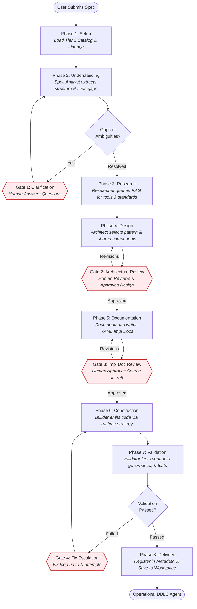

# DDLC Agent Studio — Overall Architecture

## High-Level Visual Architecture, Meta-Agent Creation Lifecycle, and Unified Metadata Framework

> **Document Status**: Living Architecture Document (v1.0)  
> **Last Updated**: 2026-11-14  
> **Audience**: Engineering Leadership, Agent Architects, Data Platform Engineers  
> **Current Workspace State**: Core Meta-Agent & Metadata Framework in Active Design; DDLC Target Agents Pending Selection & Spec  

---

## 1. Executive Overview & Vision

**DDLC Agent Studio** is an autonomous engineering studio designed to author, build, govern, and monitor specialized AI agents across the **Data Development Lifecycle (DDLC)**.

Instead of writing fragmented, fragile agent scripts by hand, the studio introduces a **Meta-Agent** — an intelligent agent factory powered by deterministic orchestration and specialized LLM reasoning. You supply high-level specifications and data contracts; the Meta-Agent clarifies ambiguities, performs technical research, designs an optimal architecture, drafts machine-actionable implementation documents, and compiles production-ready DDLC agent codebases.

```
┌────────────────────────────────────────────────────────────────────────────────────────┐
│                                   DDLC AGENT STUDIO                                    │
│                                                                                        │
│   Developer / Spec            Meta-Agent Factory                 Generated DDLC Agents │
│  ┌───────────────────┐       ┌────────────────────────┐         ┌────────────────────┐ │
│  │                   │       │  Deterministic Control │         │ Ingestion Agent    │ │
│  │  Declarative Spec │──────>│           +            │────────>│ Data Quality Agent │ │
│  │  & Data Contracts │       │  Specialist Reasoners  │         │ Governance Agent   │ │
│  │                   │       │   (LangGraph Studio)   │         │ (Custom Runtimes)  │ │
│  └───────────────────┘       └───────────┬────────────┘         └─────────┬──────────┘ │
│                                          │                                │            │
│                       writes & discovers │             records telemetry  │            │
│                       shared components  │             & stage lineage    │            │
│                                          ▼                                ▼            │
│                              ┌────────────────────────────────────────────────┐        │
│                              │        UNIFIED 3-TIER METADATA FRAMEWORK       │        │
│                              │             (PostgreSQL + pgvector)            │        │
│                              │                                                │        │
│                              │   Tier 1: Generic Agent Telemetry & Audits     │        │
│                              │   Tier 2: DDLC Catalog, Lineage & Contracts    │        │
│                              │   Tier 3: Agent-Specific Operational Schemas   │        │
│                              └────────────────────────────────────────────────┘        │
└────────────────────────────────────────────────────────────────────────────────────────┘
```

### Core Architecture Pillars

1. **Orchestration Over Prompting ("The Graph Orchestrates, the LLM Reasons")**:  
   The Meta-Agent's workflow is governed by a deterministic LangGraph state machine with strict phase boundaries, loops, safety valves, and mandatory human approval gates.
2. **Contract-Driven Compilation**:  
   Code is never generated directly from conversational chat. It is compiled from versioned YAML data contracts and implementation documents (`Single Source of Truth`).
3. **Unified Three-Tier Metadata**:  
   Telemetry, catalogs, lineage, and audit trails are managed across a standardized 3-tier PostgreSQL database, provisioned deterministically by the GitOps-driven DCM Schema Engine.
4. **Living, Iterative Portfolio**:  
   The studio grows with every build. Generated agents, reusable shared components, and architecture decisions are automatically registered to inform future builds.

---

## 2. High-Level Studio Architecture

The studio decouples developer interaction, factory synthesis, knowledge retrieval, and persistent storage into five cohesive layers:

```
┌─────────────────────────────────────────────────────────────────────────────────────────────────────────┐
│                                            PRESENTATION LAYER                                           │
│                                                                                                         │
│              Chainlit UI (Conversational Chat, Human Gate Approvals, Streaming Telemetry)               │
│                                    GitOps CLI (dcm validate / plan / apply)                             │
└───────────────────────────────────────────────────┬─────────────────────────────────────────────────────┘
                                                    │
                                                    ▼
┌─────────────────────────────────────────────────────────────────────────────────────────────────────────┐
│                                          META-AGENT ENGINE                                              │
│                                                                                                         │
│   ┌─────────────────────────────────────────────────────────────────────────────────────────────────┐   │
│   │                      COORDINATOR (LangGraph Deterministic State Machine)                        │   │
│   │                                                                                                 │   │
│   │   Phase Sequencing  •  Human Gate Enforcement  •  Safety Valve Loops  •  Build/Change Modes    │   │
│   └──────┬──────────────┬──────────────┬──────────────────┬─────────────────┬─────────────────┬─────┘   │
│          │              │              │                  │                 │                 │         │
│          ▼              ▼              ▼                  ▼                 ▼                 ▼         │
│   ┌─────────────┐┌─────────────┐┌─────────────┐    ┌─────────────┐   ┌─────────────┐   ┌─────────────┐  │
│   │Spec Analyst ││ Researcher  ││  Architect  │    │Documentarian│   │   Builder   │   │  Validator  │  │
│   │ parses spec ││feasibility &││  pattern &  │    │ writes YAML │   │ emits code  │   │ checks code │  │
│   │ finds gaps  ││ tool checks ││ runtime map │    │  impl docs  │   │  & configs  │   │  vs. docs   │  │
│   └─────────────┘└─────────────┘└─────────────┘    └─────────────┘   └─────────────┘   └─────────────┘  │
│          │              │              │                  │                 │                 │         │
│          └──────────────┴──────────────┼──────────────────┴─────────────────┴─────────────────┘         │
│                                        ▼                                                                │
│                        BLACKBOARD WORKING STATE (In-Memory Slice)                                       │
│                     (Append-Only Run Context • Projections per Specialist)                              │
└────────────────────────────────────────┬────────────────────────────────────────────────────────────────┘
                                         │
                    ┌────────────────────┴───────────────────┐
                    ▼                                        ▼
┌────────────────────────────────────────┐ ┌────────────────────────────────────────────────────────────┐
│          KNOWLEDGE LAYER (RAG)         │ │            PERSISTENT METADATA & SCHEMA ENGINE             │
│                                        │ │                                                            │
│   • Library & Tool Docs (Snowflake,    │ │   ┌────────────────────────────────────────────────────┐   │
│     PySpark, Kafka, Great Expectations)│ │   │               DCM SCHEMA ENGINE                    │   │
│   • Organizational Standards           │ │   │     (Declarative GitOps with SQLGlot + Alembic)    │   │
│   • Architecture Pattern Catalog       │ │   └─────────────────────────┬──────────────────────────┘   │
│   • Past Architecture Decisions        │ │                             │ manages & migrates           │
│   • Component & Code Conventions       │ │                             ▼                              │
│                                        │ │   ┌────────────────────────────────────────────────────┐   │
│   pgvector Embeddings / Similarity     │ │   │         POSTGRESQL METADATA FRAMEWORK (3 TIERS)    │   │
│   (Domain-Tagged Specialist Queries)   │ │   │                                                    │   │
│                                        │ │   │  Tier 1: agent_metadata (Universal Telemetry)      │   │
│                                        │ │   │  Tier 2: ddlc_shared_metadata (Catalog & Lineage)  │   │
│                                        │ │   │  Tier 3: ddlc_<agent>_metadata (Agent Staging)     │   │
│                                        │ │   │  LangGraph Checkpoints (State Resumption)          │   │
│                                        │ │   └────────────────────────────────────────────────────┘   │
└────────────────────────────────────────┘ └────────────────────────────────────────────────────────────┘
                                         │
                                         ▼
┌─────────────────────────────────────────────────────────────────────────────────────────────────────────┐
│                                 GENERATED DDLC AGENTS (RUNTIMES ON DISK)                                │
│                                                                                                         │
│   ┌───────────────────────────┐ ┌───────────────────────────┐ ┌──────────────────────────────────────┐  │
│   │   LangGraph State Agent   │ │   Python Script Pipeline  │ │       Streaming Event Agent          │  │
│   │   (Stage-Gated PAT-01)    │ │   (Batch / Micro-Batch)   │ │       (Kafka / Real-time)            │  │
│   └───────────────────────────┘ └───────────────────────────┘ └──────────────────────────────────────┘  │
└─────────────────────────────────────────────────────────────────────────────────────────────────────────┘
```

---

## 3. How the Meta-Agent Creates & Enhances DDLC Agents

The Meta-Agent operates on a **Coordinator-Specialist** pattern. The deterministic Coordinator directs the process, while six intelligent Specialists perform discrete, scoped tasks.

### 3.1 The Creation Lifecycle (New Build Flow)

The Meta-Agent uses the **Funnel Principle**: broad, unstructured requirements are progressively distilled into validated code through strict human gates.



#### Step-by-Step Breakdown

| Stage | Specialist | Role & Responsibilities | Exit Condition |
|---|---|---|---|
| **1. Ingestion** | **Coordinator** | Initializes run in `agent_run_header` (Tier 1) and pulls active shared assets from Tier 2 catalog. | State initialized. |
| **2. Understanding** | **Spec Analyst** | Parses YAML spec; verifies schema; isolates ambiguities, missing contracts, or conflicting rules. | All gaps clarified with human at **Gate 1**. |
| **3. Feasibility** | **Researcher** | Queries RAG for tool capability, connector limitations, and corporate data policy compliance. | Feasibility verdict produced. |
| **4. Architecture** | **Architect** | Selects architecture pattern (e.g. Staged-Gated `PAT-01`); assigns runtime; maps shared components. | Approved by human at **Gate 2**. |
| **5. Documentation** | **Documentarian** | Authoritative YAML implementation documents detailing every stage, schema, hook, and SLA. | Approved by human at **Gate 3**. |
| **6. Construction** | **Builder** | Compiles YAML into source code, test suites, and Docker/config manifests per chosen runtime strategy. | Codebase generated on disk. |
| **7. Validation** | **Validator** | Validates generated code against implementation docs (zero hardcoded values, contracts intact). | All checks pass or **Gate 4** escalation. |
| **8. Delivery** | **Coordinator** | Deploys agent to `agents/<agent_name>`, updates Tier 2 registries, and appends past decisions to RAG. | Agent ready for operation. |

---

### 3.2 The Enhancement Lifecycle (Iterative Change Flow)

When an existing DDLC agent needs modification (e.g., adding a stage, updating a schema, or changing SLAs), the Meta-Agent enters the **Maintenance Flow**:

```
                       ┌──────────────────────────────┐
                       │   User Requests Change or    │
                       │     Edits Existing Spec      │
                       └──────────────┬───────────────┘
                                      │
                                      ▼
                       ┌──────────────────────────────┐
                       │    Phase 1: Setup Context    │
                       │ Load Agent Registry & Impl   │
                       └──────────────┬───────────────┘
                                      │
                                      ▼
                       ┌──────────────────────────────┐
                       │  Phase 2: Change Analysis    │
                       │ Spec Analyst identifies diff │
                       └──────────────┬───────────────┘
                                      │
                                      ▼
                       ┌──────────────────────────────┐
                       │   Phase 3: Impact Analysis   │
                       │ Architect queries Tier 2     │
                       │ contract_lineage & deps      │
                       └──────────────┬───────────────┘
                                      │
                                      ▼
                       ┌──────────────────────────────┐
                       │ Phase 4: Doc Synchronization │
                       │ Documentarian updates YAML   │
                       └──────────────┬───────────────┘
                                      │
                        Human Gate: Review Updated Docs
                                      │
                 ┌────────────────────┴────────────────────┐
                 ▼                                         ▼
   ┌───────────────────────────┐             ┌───────────────────────────┐
   │ Phase 5: Rebuild Affected │             │ Phase 6: Validate & Deploy│
   │ Builder updates only the  │────────────>│ Validator checks diffs;   │
   │ modified stages & tests   │             │ Tier 2 lineage is updated │
   └───────────────────────────┘             └───────────────────────────┘
```

1. **Impact Analysis**: Queries Tier 2 `agent_dependency` and `contract_lineage` via SQL to detect if downstream DDLC agents are affected.
2. **Selective Compilation**: Only the affected stages, contract validators, and integration tests are recompiled by the Builder.
3. **Audit Trail**: Every change is logged to `agent_metadata.audit_log` and `decision_log` for governance traceability.

---

## 4. The Studio Repository & Folder Structure

The repository maintains strict boundaries between meta-tooling, metadata management, and generated DDLC agent codebases:

```
ddlc-agent-studio/
├── .github/                         # CI/CD workflows, GitOps automation
├── _shared/                         # ALL SHARED ASSETS (Code Components + RAG Knowledge)
│   ├── components/                  # Reusable Python Code Modules (Tier 2 Catalog Assets)
│   │   ├── pii/                     # PII masking & tokenization modules
│   │   ├── quality/                 # Great Expectations & custom validation rules
│   │   └── formatters/              # Common schema adapters & serializers
│   │
│   └── knowledge/                   # Shared RAG Corpus & Pattern Repository
│       ├── library_docs/            # Tool references (Snowflake, PySpark, Kafka, dbt)
│       ├── org_standards/           # Compliance, naming conventions, governance policies
│       ├── pattern_catalog/         # Catalog of agent architecture patterns (PAT-01, etc.)
│       ├── past_decisions/          # Stored build outcomes and architectural trade-offs
│       └── code_conventions/        # Coding styles, testing guidelines, packaging rules
│
├── config/                          # Studio-wide environment & LLM tier configurations
│   ├── settings.yaml                # Database connections, workspace root paths
│   ├── model_tiers.yaml             # Model mappings (Tier 1 heavy reasoning vs. Tier 3 fast)
│   └── safety_valves.yaml           # Max clarification and fix-loop limits
│
├── contracts/                       # DECLARATIVE METADATA CONTRACTS (GitOps Source of Truth)
│   ├── tier_1_agent_metadata.yaml   # Universal agent telemetry & audit schema contract
│   ├── tier_2_ddlc_shared.yaml      # DDLC catalog, contracts, lineage schema contract
│   └── templates/                   # Template contracts for future Tier 3 agent schemas
│
├── design-docs/                     # ARCHITECTURAL DESIGN & BLUEPRINTS
│   ├── ddlc-agnet-studio-architecture.md  # THIS LIVING OVERALL ARCHITECTURE DOC
│   ├── meta-agent/                  # Meta-agent detailed design specifications
│   │   ├── 01_approach.md           # Core philosophy & state machine rationale
│   │   ├── 02_architecture.md       # Coordinator-specialist & blackboard blueprint
│   │   └── decision.log             # Major architectural decision log
│   ├── metadata-framework/          # 3-tier metadata framework specifications
│   │   ├── 01_metadata_framework.md # Framework architecture, schemas, and queries
│   │   └── tier_1_data_dictionary.md# Column-level data dictionary for Tier 1
│   ├── dcm-agent/                   # DCM Schema Engine design
│   │   └── dcm_agent.md             # Deterministic Alembic + SQLGlot compiler design
│   └── ddlc-agents/                 # SPECS & DESIGNS FOR FUTURE DDLC AGENTS (Iterative)
│       └── README.md                # Roadmap & agent candidate definitions
│
├── src/                             # ACTIVE STUDIO SOURCE CODE
│   ├── meta_agent/                  # Meta-Agent Factory Implementation
│   │   ├── coordinator/             # LangGraph state machine & deterministic routing
│   │   ├── specialists/             # LLM domain nodes (Spec Analyst, Builder, etc.)
│   │   ├── state/                   # Blackboard schemas & projection mappers
│   │   └── ui/                      # Chainlit UI application and gate handlers
│   │
│   ├── dcm/                         # DCM Schema Engine CLI & Core
│   │   ├── compiler.py              # SQLGlot AST schema compiler
│   │   ├── migrator.py              # Alembic auto-migration engine
│   │   └── cli.py                   # GitOps CLI entry point (`dcm plan / apply`)
│   │
│   └── common/                      # Shared database connectors & utilities
│
├── agents/                          # GENERATED DDLC AGENTS WORKSPACE (Empty / In Dev)
│   └── .gitkeep                     # Target directory where Meta-Agent builds agents
│
├── tests/                           # Studio verification suites
├── pyproject.toml                   # Python dependencies & studio packaging
└── README.md                        # Project root documentation
```

---

## 5. The Unified Metadata Framework

Persistent state is decoupled from the Meta-Agent's short-lived working memory. The studio utilizes a **Three-Tier Architecture** categorized into **Four Functional Concerns**:

```
┌────────────────────────────────────────────────────────────────────────────────────────┐
│                                 THE THREE TIERS                                        │
│                                                                                        │
│   TIER 3: Agent-Specific Metadata (Schema: ddlc_<agent_name>_metadata)                │
│   • Source-specific profiling statistics (null rates, distributions, cardinality)      │
│   • Agent-local staging state, offsets, watermark bookmarks, and checkpoints           │
│                                                                                        │
│   TIER 2: DDLC Shared Metadata (Schema: ddlc_shared_metadata)                          │
│   • Catalog: agent_registry, component_registry (with pgvector), contract_registry     │
│   • Lineage: contract_lineage, agent_dependency, component_usage                       │
│   • Operational: build_summary, stage_execution, data_quality_summary, config_snapshot │
│   • Audit: governance_audit, stage_gate_record                                         │
│                                                                                        │
│   TIER 1: Agent Metadata (Generic) (Schema: agent_metadata)                            │
│   • Catalog: artifact_registry, artifact_manifest                                      │
│   • Operational: agent_run_header, execution_log (telemetry, tokens, durations)        │
│   • Audit: audit_log (immutable security events), decision_log (explainability)        │
└────────────────────────────────────────────────────────────────────────────────────────┘
```

### 5.1 The Four Functional Concerns

| Concern | Primary Question Answered | Key Tables Across Tiers | Industry Analogue |
|---|---|---|---|
| **Catalog** | *What assets exist and where are they?* | `artifact_registry`, `agent_registry`, `component_registry`, `contract_registry` | DataHub, Unity Catalog |
| **Lineage** | *How do agents and contracts connect?* | `contract_lineage`, `agent_dependency`, `component_usage`, `artifact_manifest` | OpenLineage, Marquez |
| **Operational** | *What occurred during execution?* | `agent_run_header`, `execution_log`, `stage_execution`, `build_summary`, `data_quality_summary` | OpenTelemetry, Airflow DB |
| **Audit** | *Who approved what, when, and why?* | `audit_log`, `decision_log`, `governance_audit`, `stage_gate_record` | Compliance & SecOps Logs |

---

### 5.2 Deterministic Schema Lifecycle: The DCM Schema Engine

To eliminate schema corruption and probabilistic LLM errors, the **DCM Schema Engine** provisions and migrates the metadata database directly from declarative YAML contracts:

```
┌───────────────────────────────┐
│ Declarative YAML Contracts    │  Single Source of Truth in Git
│ (contracts/tier_*.yaml)       │
└───────────────┬───────────────┘
                │
                ▼
┌───────────────────────────────┐
│ SQLGlot Contract Compiler     │  1. Validates types and cross-table FKs
│ (Deterministic AST Engine)    │  2. Emits canonical PostgreSQL DDL
└───────────────┬───────────────┘
                │
                ▼
┌───────────────────────────────┐
│ Alembic Migration Manager     │  1. Diffs AST against live DB catalog
│ (GitOps Migration Lifecycle)  │  2. Generates versioned migration scripts
└───────────────┬───────────────┘  3. Halts on destructive changes (Human Gate)
                │
                ▼
┌───────────────────────────────┐
│ PostgreSQL Metadata Database  │  Zero hallucination risk;
│ (agent_metadata, ddlc_shared) │  100% reproducible GitOps state
└───────────────────────────────┘
```

> [!IMPORTANT]
> **Deterministic DDL Execution**:  
> LLMs are never used to execute raw SQL migrations. LLMs (including Antigravity or the Meta-Agent) only suggest edits to declarative YAML contracts in Git. The DCM compiler deterministically generates and executes migrations using **SQLGlot** and **Alembic**.

---

## 6. Generated DDLC Agents: Architecture Patterns & Runtimes

The Meta-Agent is runtime-agnostic. The Documentarian produces implementation documents specifying *what* must be executed, while the Builder selects the appropriate **Generation Strategy**:

```
                       ┌──────────────────────────────┐
                       │   YAML Implementation Doc    │
                       │   (Runtime-Agnostic Spec)    │
                       └──────────────┬───────────────┘
                                      │
                                      ▼
                       ┌──────────────────────────────┐
                       │   Builder Specialist Engine  │
                       │ (Selects Generation Strategy)│
                       └──────────────┬───────────────┘
                                      │
         ┌────────────────────────────┼────────────────────────────┐
         ▼                            ▼                            ▼
┌──────────────────┐         ┌──────────────────┐         ┌──────────────────┐
│ LangGraph State  │         │  Python Pipeline │         │ Streaming Event  │
│ Machine Strategy │         │     Strategy     │         │     Strategy     │
├──────────────────┤         ├──────────────────┤         ├──────────────────┤
│ Staged-Gated     │         │ Linear batch     │         │ Real-time Kafka  │
│ Pipeline(PAT-01) │         │ processing       │         │ consumer/producer│
│ Human gates,     │         │ Scheduled cron,  │         │ Continuous       │
│ recovery branches│         │ low-complexity   │         │ micro-batches    │
└──────────────────┘         └──────────────────┘         └──────────────────┘
```

---

## 7. Portfolio Status & Living Iteration Roadmap

As of today, no individual DDLC agents have been built or finalized. This section serves as the **Living Tracker** for the studio.

### 7.1 Component Status Dashboard

| Component / Subsystem | Design Status | Code Status | Source / Documentation |
|---|---|---|---|
| **Meta-Agent Architecture** | Approved (v0.4) | In Development | [02_architecture.md](file:///S:/DATA/agents/ddlc-agent-studio/design-docs/meta-agent/02_architecture.md) |
| **Metadata Framework (Tier 1 & 2)** | Approved (v0.2) | Contract Complete | [01_metadata_framework.md](file:///S:/DATA/agents/ddlc-agent-studio/design-docs/metadata-framework/01_metadata_framework.md) |
| **DCM Schema Engine** | Approved (v0.2) | Compiler Scaffolded | [dcm_agent.md](file:///S:/DATA/agents/ddlc-agent-studio/design-docs/dcm-agent/dcm_agent.md) |
| **RAG Knowledge Base & Embeddings** | Architecture Defined| Pending Corpus Ingestion | `_shared/knowledge/` |
| **DDLC Target Agents** | **Planning Phase** | **Not Started** | Section 7.2 below |

---

### 7.2 Future DDLC Agent Candidates (For Iterative Expansion)

The table below outlines candidate DDLC agents being considered for upcoming development cycles. As agents are selected, their status will update here:

```
┌────────────────────────────────────────────────────────────────────────────────────────┐
│                              DDLC AGENT CANDIDATE REGISTRY                             │
│                                                                                        │
│  [AGT-01] Ingestion & Source Extractor Agent                                           │
│  Connects to upstream endpoints (S3, Kafka, APIs), extracts source schemas, profiles    │
│  source data, and writes raw staging contracts.                                        │
│  Status: CANDIDATE  •  Target Runtime: Python / Streaming                              │
│                                                                                        │
│  [AGT-02] Data Quality & Contract Enforcement Agent                                    │
│  Runs automated Great Expectations assertions, verifies contract schemas, quarantines  │
│  invalid rows, and logs quality scores to Tier 2 metadata.                             │
│  Status: CANDIDATE  •  Target Runtime: LangGraph Staged-Gated (PAT-01)                 │
│                                                                                        │
│  [AGT-03] Governance, PII & Compliance Agent                                           │
│  Scans columns for sensitive data, applies cryptographic hashing or tokenization,      │
│  records audit events, and enforces retention policies.                                │
│  Status: CANDIDATE  •  Target Runtime: LangGraph Stateful                              │
│                                                                                        │
│  [AGT-04] Schema Evolution & Migration Agent                                           │
│  Detects upstream schema drift, alerts on breaking type conversions, and coordinates   │
│  with DCM Engine to evolve downstream staging tables safely.                          │
│  Status: CANDIDATE  •  Target Runtime: Python CLI / Event                              │
│                                                                                        │
│  [AGT-05] Data Transformation & Warehouse Delivery Agent                               │
│  Orchestrates dbt model execution, executes idempotent warehouse merges into Snowflake/ │
│  Databricks, and establishes final consumption contracts.                              │
│  Status: CANDIDATE  •  Target Runtime: Python Pipeline / Dagster                       │
└────────────────────────────────────────────────────────────────────────────────────────┘
```

---

### 7.3 How to Iterate on this Document

As you progress through studio development:
1. **Selecting an Agent**: Update the status from `CANDIDATE` to `IN DESIGN`, create a dedicated design doc under `design-docs/ddlc-agents/<agent_name>.md`, and link it here.
2. **Post-Build Registration**: Once the Meta-Agent compiles an agent, register its version, architecture pattern, and runtime in Section 7.2 and the Tier 2 `agent_registry`.
3. **Recording Architecture Insights**: When new patterns or constraints emerge from builds, record them in `design-docs/meta-agent/decision.log` and update the visual flows in this document.

---

> [!TIP]
> **Related Documentation Links**:
> - [Meta-Agent Approach & State Machine Philosophy](file:///S:/DATA/agents/ddlc-agent-studio/design-docs/meta-agent/01_approach.md)
> - [Meta-Agent Coordinator & Specialist Architecture](file:///S:/DATA/agents/ddlc-agent-studio/design-docs/meta-agent/02_architecture.md)
> - [Unified Three-Tier Metadata Framework](file:///S:/DATA/agents/ddlc-agent-studio/design-docs/metadata-framework/01_metadata_framework.md)
> - [Tier 1 Metadata Data Dictionary](file:///S:/DATA/agents/ddlc-agent-studio/design-docs/metadata-framework/tier_1_data_dictionary.md)
> - [DCM Schema Engine Design (Alembic + SQLGlot)](file:///S:/DATA/agents/ddlc-agent-studio/design-docs/dcm-agent/dcm_agent.md)
> - [Stage-Gated Pipeline Pattern (`PAT-01`)](file:///S:/DATA/agents/ddlc-agent-studio/agent-architecture-patterns/stage-gated/01-staged-gated-pipeline.md)
