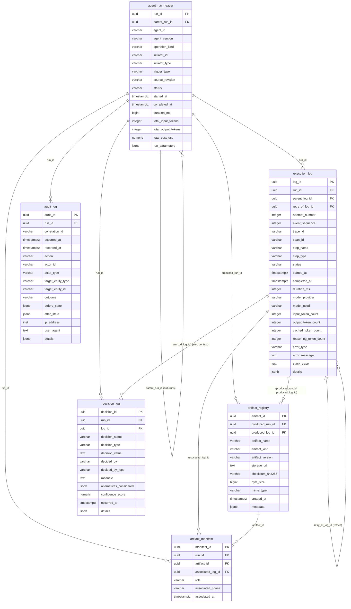

# DDLC Agent Studio — Tier 1 Data Dictionary

## Schema: `agent_metadata`

> **Document Status**: Production-Ready Baseline v1.1  
> **Last Updated**: 2026-11-13  
> **Target Database Engine**: PostgreSQL 14+  
> **Prerequisite**: [`01_metadata_framework.md`](file:///s:/DATA/agents/ddlc-agent-studio/design-docs/metadata-framework/01_metadata_framework.md)  
> **Governing Agent**: DCM (Data Catalog Management) Agent  

---

## 1. Overview & Architectural Boundaries

The `agent_metadata` schema encompasses the **Tier 1 (Generic Agent Metadata)** layer of the DDLC Agent Studio. It is domain-agnostic and designed to support any autonomous agent system (meta-agent, pipeline agents, or external tools).

### Core Responsibilities:
1. **Execution & Observability**: Structured execution spans, parent-child task hierarchy, retry attempts, model telemetry (cached/reasoning tokens, latency), and error capture.
2. **Artifact Catalog & Provenance**: Global registry of immutable digital assets (`storage_uri`, SHA-256 digests) and per-run Bill of Materials (inputs vs. outputs).
3. **Auditability & Compliance**: Enforced append-only audit trail capturing authorization, identity, and security state modifications.
4. **Explainability & Decisions**: Captures both pending and resolved decision points, alternatives evaluated, confidence scores, and natural-language rationale.

### Tier 1 vs. Tier 2 Boundary Rule:
Tier 1 contains **no domain-specific vocabularies** (e.g., no hardcoded DDLC stages, no DDLC artifact types like `impl_doc` or `spec`, and no pipeline-specific states). Tier 1 tables use open or generic categories (`artifact_kind`, `operation_kind`), while Tier 2 (`ddlc_shared_metadata`) specializes these for the Data Development Lifecycle.

---

## 2. Entity-Relationship (ER) Diagram



---

## 3. Detailed Data Dictionary

### 3.1 `agent_run_header`
* **Concern**: Operational  
* **Purpose**: Master execution record for an agent workflow run. Serves as the primary anchor (`run_id`) across all child tables.

| Column Name | Data Type | Nullable | Default | Constraints | Description |
|---|---|---|---|---|---|
| `run_id` | `UUID` | No | `gen_random_uuid()` | **PK** | Unique execution run identifier. Can be pre-generated client-side by orchestrators (e.g., LangGraph). |
| `parent_run_id` | `UUID` | Yes | `NULL` | **FK** `-> agent_run_header(run_id)` | Parent run ID if this execution is a sub-agent or child workflow. |
| `agent_id` | `VARCHAR(100)` | No | — | — | Logical identifier of the agent (e.g., `meta-agent`, `customer-pipeline-agent`). |
| `agent_version` | `VARCHAR(50)` | No | — | — | Semantic version of the agent code / configuration. |
| `operation_kind` | `VARCHAR(50)` | No | `'standard'` | — | Generic run category (e.g., `standard`, `build`, `maintenance`, `test`, `eval`). Extensible in Tier 2. |
| `initiator_id` | `VARCHAR(100)` | No | — | — | Identity of the initiator (user email, service account, parent agent ID). |
| `initiator_type` | `VARCHAR(30)` | No | — | `CHECK (initiator_type IN ('human', 'agent', 'system', 'schedule'))` | Type of actor initiating the run. |
| `trigger_type` | `VARCHAR(30)` | No | — | `CHECK (trigger_type IN ('manual', 'api', 'schedule', 'event', 'parent_run'))` | Invocation mechanism. |
| `source_revision` | `VARCHAR(100)` | Yes | `NULL` | — | First-class Git commit SHA, container image digest, or version tag. |
| `status` | `VARCHAR(30)` | No | `'running'` | `CHECK (status IN ('running', 'completed', 'failed', 'cancelled', 'paused', 'timed_out'))` | Run lifecycle status. |
| `started_at` | `TIMESTAMPTZ` | No | `clock_timestamp()` | — | Execution start timestamp. |
| `completed_at` | `TIMESTAMPTZ` | Yes | `NULL` | — | Terminal timestamp (enforced by lifecycle check constraints). |
| `duration_ms` | `BIGINT` | Yes | `NULL` | — | Total run duration in ms (cached rollup for dashboard performance). |
| `total_input_tokens` | `INTEGER` | No | `0` | — | Cached rollup of prompt tokens consumed across all steps. |
| `total_output_tokens`| `INTEGER` | No | `0` | — | Cached rollup of completion tokens across all steps. |
| `total_cost_usd` | `NUMERIC(10, 6)` | No | `0.000000` | — | Cached financial rollup in USD based on model pricing. |
| `run_parameters` | `JSONB` | No | `'{}'::jsonb` | — | Sanitized context payload: CLI args, environment variables, non-sensitive flags. |

**Lifecycle & Data Integrity Constraints**:
* `chk_run_duration`: `CHECK (completed_at IS NULL OR completed_at >= started_at)`
* `chk_run_terminal_completed`: `CHECK (status NOT IN ('completed', 'failed', 'cancelled', 'timed_out') OR completed_at IS NOT NULL)`
* `chk_run_running_completed`: `CHECK (status != 'running' OR completed_at IS NULL)`

**Indexes & Keys**:
* Primary Key: `agent_run_header_pkey (run_id)`
* Foreign Key: `fk_run_parent (parent_run_id) REFERENCES agent_run_header(run_id) ON DELETE SET NULL`
* Indexes:
  * `idx_run_agent_status (agent_id, status)`
  * `idx_run_started_at (started_at DESC)`
  * `idx_run_parent (parent_run_id)`
  * `idx_run_revision (source_revision)`

---

### 3.2 `execution_log`
* **Concern**: Operational  
* **Purpose**: Time-ordered execution log of individual spans, node tasks, and tool calls within a run. Conforms to structured span semantics with explicit retry tracking and composite same-run integrity.

| Column Name | Data Type | Nullable | Default | Constraints | Description |
|---|---|---|---|---|---|
| `log_id` | `UUID` | No | `gen_random_uuid()` | **PK** | Unique step/span identifier. |
| `run_id` | `UUID` | No | — | **FK** `-> agent_run_header(run_id)` | Execution run reference. |
| `parent_log_id` | `UUID` | Yes | `NULL` | **FK** `-> execution_log(run_id, log_id)` | Parent span for nested sub-tasks or tool calls (strictly within same run). |
| `retry_of_log_id`| `UUID` | Yes | `NULL` | **FK** `-> execution_log(run_id, log_id)` | Points to the previous failed attempt span if this is a retry. |
| `attempt_number` | `INTEGER` | No | `1` | `CHECK (attempt_number >= 1)` | Monotonic attempt index for retried operations (`1, 2, 3...`). |
| `event_sequence` | `INTEGER` | No | — | — | Coordinator dispatch sequence order within the run. |
| `trace_id` | `VARCHAR(64)` | Yes | `NULL` | — | Distributed trace identifier (e.g., OpenTelemetry 128-bit hex). |
| `span_id` | `VARCHAR(32)` | Yes | `NULL` | — | Distributed span identifier (e.g., OpenTelemetry 64-bit hex). |
| `step_name` | `VARCHAR(100)` | No | — | — | Identifier of the node, agent specialist, or function. |
| `step_type` | `VARCHAR(30)` | No | `'node'` | `CHECK (step_type IN ('node', 'tool_call', 'llm_call', 'gate', 'system'))` | Semantic category of the span. |
| `status` | `VARCHAR(30)` | No | `'started'` | `CHECK (status IN ('started', 'completed', 'failed', 'skipped', 'timed_out'))` | Span lifecycle status. |
| `started_at` | `TIMESTAMPTZ` | No | `clock_timestamp()` | — | Span start timestamp. |
| `completed_at` | `TIMESTAMPTZ` | Yes | `NULL` | — | Span end timestamp. |
| `duration_ms` | `INTEGER` | Yes | `NULL` | — | Span duration in ms (`completed_at - started_at`). |
| `model_provider` | `VARCHAR(50)` | Yes | `NULL` | — | Provider name (e.g., `anthropic`, `google`, `openai`, `ollama`). |
| `model_used` | `VARCHAR(100)` | Yes | `NULL` | — | Model descriptor (e.g., `claude-3-5-sonnet-20241022`). |
| `input_token_count` | `INTEGER` | No | `0` | — | Standard prompt/input tokens. |
| `output_token_count`| `INTEGER` | No | `0` | — | Completion/output tokens generated. |
| `cached_token_count`| `INTEGER` | No | `0` | — | Prompt tokens read from provider cache (critical for cost attribution). |
| `reasoning_token_count`| `INTEGER` | No | `0` | — | Internal reasoning/thought tokens (e.g., o1/Gemini thinking). |
| `error_type` | `VARCHAR(100)` | Yes | `NULL` | — | Categorized exception name (`RateLimitError`, `ValidationError`). |
| `error_message` | `TEXT` | Yes | `NULL` | — | Sanitized error summary. |
| `stack_trace` | `TEXT` | Yes | `NULL` | — | Sanitized stack trace (truncated to policy limit, e.g. 32KB). |
| `details` | `JSONB` | No | `'{}'::jsonb` | — | Sanitized input parameters, output summaries, tool parameters. |

**Composite Constraints & Integrity**:
* Primary Key: `execution_log_pkey (log_id)`
* Composite Unique: `uq_execution_run_log UNIQUE (run_id, log_id)` — **Enforces same-run reference integrity.**
* Foreign Keys:
  * `fk_exec_run`: `(run_id) REFERENCES agent_run_header(run_id) ON DELETE CASCADE`
  * `fk_exec_parent`: `FOREIGN KEY (run_id, parent_log_id) REFERENCES execution_log(run_id, log_id) ON DELETE CASCADE`
  * `fk_exec_retry`: `FOREIGN KEY (run_id, retry_of_log_id) REFERENCES execution_log(run_id, log_id) ON DELETE SET NULL`
* Step Lifecycle Constraints:
  * `chk_exec_duration`: `CHECK (completed_at IS NULL OR completed_at >= started_at)`
  * `chk_exec_terminal`: `CHECK (status NOT IN ('completed', 'failed', 'skipped', 'timed_out') OR completed_at IS NOT NULL)`

**Indexes**:
* `idx_exec_run_seq (run_id, event_sequence ASC)`
* `idx_exec_time_range (started_at, completed_at)`
* `idx_exec_parent (run_id, parent_log_id)`
* `idx_exec_otel_trace (trace_id, span_id)`
* Partial index for failures: `CREATE INDEX idx_exec_failed ON agent_metadata.execution_log (run_id, error_type) WHERE status = 'failed';`

---

### 3.3 `artifact_registry`
* **Concern**: Catalog  
* **Purpose**: Central catalog of every versioned digital asset produced across runs or registered as pre-existing inputs. Tracks universal storage URIs and cryptographic digests.

| Column Name | Data Type | Nullable | Default | Constraints | Description |
|---|---|---|---|---|---|
| `artifact_id` | `UUID` | No | `gen_random_uuid()` | **PK** | Unique asset identifier. |
| `produced_run_id` | `UUID` | Yes | `NULL` | **FK** `-> agent_run_header(run_id)` | Run that generated this artifact. Nullable for external/pre-existing seed inputs. |
| `produced_log_id` | `UUID` | Yes | `NULL` | **FK** `-> execution_log(log_id)` | Specific execution span that output this asset. |
| `artifact_name` | `VARCHAR(255)` | No | — | — | Logical asset filename (e.g., `pipeline_blueprint.md`). |
| `artifact_kind` | `VARCHAR(50)` | No | — | — | Generic category (`document`, `code`, `config`, `schema`, `dataset`, `binary`). Extensible. |
| `artifact_version` | `VARCHAR(50)` | No | `'1.0.0'` | — | Semantic or content version tag. |
| `storage_uri` | `TEXT` | No | — | — | Uniform Resource Identifier (`file:///...`, `s3://...`, `gs://...`, `git://...`). |
| `checksum_sha256` | `VARCHAR(64)` | No | — | — | SHA-256 cryptographic digest of the target content. |
| `byte_size` | `BIGINT` | Yes | `NULL` | `CHECK (byte_size IS NULL OR byte_size >= 0)` | File size in bytes. |
| `mime_type` | `VARCHAR(100)` | Yes | `NULL` | — | MIME content type (e.g., `text/markdown`, `application/json`). |
| `created_at` | `TIMESTAMPTZ` | No | `clock_timestamp()` | — | Exact registration timestamp. |
| `metadata` | `JSONB` | No | `'{}'::jsonb` | — | Extensible metadata (encoding, language, tags, author). |

**Keys & Indexes**:
* Primary Key: `artifact_registry_pkey (artifact_id)`
* Foreign Key: `fk_artifact_run`: `(produced_run_id) REFERENCES agent_run_header(run_id) ON DELETE RESTRICT`
* Composite Foreign Key: `fk_artifact_step`: `FOREIGN KEY (produced_run_id, produced_log_id) REFERENCES execution_log(run_id, log_id) ON DELETE SET NULL`
* Deduplication & Lookup Indexes:
  * `idx_artifact_checksum (checksum_sha256, byte_size)` — for deduplication and integrity verification.
  * `idx_artifact_kind_name (artifact_kind, artifact_name)`
  * `idx_artifact_producer (produced_run_id, produced_log_id)`

---

### 3.4 `artifact_manifest`
* **Concern**: Catalog / Lineage  
* **Purpose**: Maps which artifacts participate in a given run (Bill of Materials). Explicitly links input consumption and output production to execution spans.

| Column Name | Data Type | Nullable | Default | Constraints | Description |
|---|---|---|---|---|---|
| `manifest_id` | `UUID` | No | `gen_random_uuid()` | **PK** | Unique manifest entry ID. |
| `run_id` | `UUID` | No | — | **FK** `-> agent_run_header(run_id)` | Execution run reference. |
| `artifact_id` | `UUID` | No | — | **FK** `-> artifact_registry(artifact_id)` | Referenced asset from the catalog. |
| `associated_log_id` | `UUID` | Yes | `NULL` | **FK** `-> execution_log(run_id, log_id)` | Specific step/span that consumed or produced this artifact. |
| `role` | `VARCHAR(30)` | No | — | `CHECK (role IN ('input', 'output', 'intermediate'))` | Role of artifact in this execution context. |
| `associated_phase` | `VARCHAR(50)` | Yes | `NULL` | — | Workflow phase or milestone during which this association occurred. |
| `associated_at` | `TIMESTAMPTZ` | No | `clock_timestamp()` | — | Timestamp of association. |

**Constraints & Keys**:
* Primary Key: `artifact_manifest_pkey (manifest_id)`
* Unique Association Constraint: `uq_run_artifact_role UNIQUE (run_id, artifact_id, role)`
* Foreign Keys:
  * `fk_manifest_run`: `(run_id) REFERENCES agent_run_header(run_id) ON DELETE CASCADE`
  * `fk_manifest_artifact`: `(artifact_id) REFERENCES artifact_registry(artifact_id) ON DELETE RESTRICT`
  * `fk_manifest_step`: `FOREIGN KEY (run_id, associated_log_id) REFERENCES execution_log(run_id, log_id) ON DELETE SET NULL`

**Indexes**:
* `idx_manifest_artifact_role (artifact_id, role)` — supports reverse dependency analysis.
* `idx_manifest_run_role (run_id, role)` — supports run Bill of Materials reconstruction.

---

### 3.5 `audit_log`
* **Concern**: Audit & Compliance  
* **Purpose**: Legally verifiable, append-only security and compliance audit trail. Captures access control, gate evaluation outcomes, state modifications, and overrides.

| Column Name | Data Type | Nullable | Default | Constraints | Description |
|---|---|---|---|---|---|
| `audit_id` | `UUID` | No | `gen_random_uuid()` | **PK** | Unique audit record identifier. |
| `run_id` | `UUID` | Yes | `NULL` | **FK** `-> agent_run_header(run_id)` | Associated run ID (nullable for system-level administrative actions). |
| `correlation_id` | `VARCHAR(100)` | Yes | `NULL` | — | Distributed trace/request ID across API gateways or user sessions. |
| `occurred_at` | `TIMESTAMPTZ` | No | `clock_timestamp()` | — | Wall-clock timestamp when the action occurred. |
| `recorded_at` | `TIMESTAMPTZ` | No | `clock_timestamp()` | — | Database commit timestamp (verifies ingestion latencies). |
| `action` | `VARCHAR(100)` | No | — | — | Security/governance action (e.g., `gate_approval`, `gate_override`, `config_update`). |
| `actor_id` | `VARCHAR(100)` | No | — | — | Identity of the actor (user handle, IAM principal, service ID). |
| `actor_type` | `VARCHAR(30)` | No | — | `CHECK (actor_type IN ('human', 'agent', 'service_account', 'system'))` | Actor classification. |
| `target_entity_type`| `VARCHAR(50)` | No | — | — | Target type (e.g., `gate`, `run`, `schema`, `artifact`, `security_policy`). |
| `target_entity_id` | `VARCHAR(100)` | Yes | `NULL` | — | Identifier of the affected entity. |
| `outcome` | `VARCHAR(30)` | No | `'success'` | `CHECK (outcome IN ('success', 'denied', 'failed', 'error'))` | Authorization or operation outcome. |
| `before_state` | `JSONB` | Yes | `NULL` | — | Sanitized state delta or cryptographic hash prior to action. |
| `after_state` | `JSONB` | Yes | `NULL` | — | Sanitized state delta or cryptographic hash after action. |
| `ip_address` | `INET` | Yes | `NULL` | — | Originating client IP address. |
| `user_agent` | `TEXT` | Yes | `NULL` | — | Client software / CLI agent identifier. |
| `details` | `JSONB` | No | `'{}'::jsonb` | — | Security context, token hash, permission scopes evaluated. |

**Keys & Indexes**:
* Primary Key: `audit_log_pkey (audit_id)`
* Foreign Key: `fk_audit_run (run_id) REFERENCES agent_run_header(run_id) ON DELETE RESTRICT`
* Indexes:
  * `idx_audit_occurred_at (occurred_at DESC)`
  * `idx_audit_actor (actor_id, occurred_at DESC)`
  * `idx_audit_target (target_entity_type, target_entity_id)`
  * `idx_audit_correlation (correlation_id)`

---

### 3.6 `decision_log`
* **Concern**: Audit & Governance  
* **Purpose**: Explainability ledger recording both in-flight and completed decision points (routing, model escalations, gate evaluations, and human sign-offs).

| Column Name | Data Type | Nullable | Default | Constraints | Description |
|---|---|---|---|---|---|
| `decision_id` | `UUID` | No | `gen_random_uuid()` | **PK** | Unique decision identifier. |
| `run_id` | `UUID` | No | — | **FK** `-> agent_run_header(run_id)` | Execution run reference. |
| `log_id` | `UUID` | Yes | `NULL` | **FK** `-> execution_log(run_id, log_id)` | Link to the exact execution span where the decision was evaluated. |
| `decision_status` | `VARCHAR(30)` | No | `'decided'` | `CHECK (decision_status IN ('pending', 'decided', 'rejected', 'cancelled'))` | Lifecycle status of the decision. |
| `decision_type` | `VARCHAR(50)` | No | — | — | Generic category (`routing`, `approval`, `escalation`, `fallback`, `parameter_tuning`). |
| `decision_value` | `TEXT` | Yes | `NULL` | — | Resolved outcome (nullable while `decision_status = 'pending'`). |
| `decided_by` | `VARCHAR(100)` | Yes | `NULL` | — | Identity of decision maker (nullable while pending). |
| `decided_by_type` | `VARCHAR(30)` | Yes | `NULL` | `CHECK (decided_by_type IS NULL OR decided_by_type IN ('human', 'agent', 'rule_engine'))` | Type of decider. |
| `rationale` | `TEXT` | Yes | `NULL` | — | Natural-language explanation of why this decision was taken (nullable while pending). |
| `alternatives_considered`| `JSONB` | Yes | `NULL` | — | JSON array of rejected alternatives and justification. |
| `confidence_score` | `NUMERIC(4, 3)` | Yes | `NULL` | `CHECK (confidence_score IS NULL OR confidence_score BETWEEN 0.000 AND 1.000)` | Confidence score for autonomous decisions. |
| `occurred_at` | `TIMESTAMPTZ` | No | `clock_timestamp()` | — | Timestamp when decision point was reached or decided. |
| `details` | `JSONB` | No | `'{}'::jsonb` | — | Evaluation rubrics, gate criteria, prompt parameters. |

**Integrity Constraints**:
* **Pending vs. Decided Integrity**:
  ```sql
  CONSTRAINT chk_decision_resolution CHECK (
      decision_status != 'decided' OR (
          decision_value IS NOT NULL AND 
          decided_by IS NOT NULL AND 
          decided_by_type IS NOT NULL AND 
          rationale IS NOT NULL
      )
  )
  ```

**Keys & Indexes**:
* Primary Key: `decision_log_pkey (decision_id)`
* Foreign Key: `fk_decision_run (run_id) REFERENCES agent_run_header(run_id) ON DELETE CASCADE`
* Composite Foreign Key: `fk_decision_step`: `FOREIGN KEY (run_id, log_id) REFERENCES execution_log(run_id, log_id) ON DELETE SET NULL`
* Indexes:
  * `idx_decision_run_time (run_id, occurred_at ASC)`
  * `idx_decision_status (decision_status)`
  * `idx_decision_step (run_id, log_id)`

---

## 4. Key Architectural & Integrity Enforcements

### 4.1 Enforced Immutability for `audit_log`
Policy statements alone do not guarantee compliance. Immutability is physically enforced at the database layer via a PostgreSQL trigger:

```sql
CREATE OR REPLACE FUNCTION agent_metadata.enforce_audit_log_immutability()
RETURNS TRIGGER AS $$
BEGIN
    RAISE EXCEPTION 'UPDATE and DELETE operations are prohibited on table agent_metadata.audit_log (Compliance Rule SEC-01)';
END;
$$ LANGUAGE plpgsql;

CREATE TRIGGER trg_audit_log_immutable
BEFORE UPDATE OR DELETE ON agent_metadata.audit_log
FOR EACH ROW EXECUTE FUNCTION agent_metadata.enforce_audit_log_immutability();
```

*In addition, application connection pools must connect using a dedicated writer role that lacks `TRUNCATE` or `DROP TABLE` privileges.*

### 4.2 Composite Foreign Keys Prevent Cross-Run Leaks
In multi-tenant or concurrent agent environments, foreign keys that only reference `log_id` can accidentally allow a record in Run A to reference a parent span or decision in Run B. 

Every relational link between spans and decisions is protected by a **composite foreign key**:
```sql
-- Execution span hierarchy within the same run:
CONSTRAINT fk_exec_parent FOREIGN KEY (run_id, parent_log_id) 
    REFERENCES agent_metadata.execution_log(run_id, log_id) ON DELETE CASCADE

-- Decision to execution span within the same run:
CONSTRAINT fk_decision_step FOREIGN KEY (run_id, log_id) 
    REFERENCES agent_metadata.execution_log(run_id, log_id) ON DELETE SET NULL
```

### 4.3 Data Sanitization & Payload Truncation Policy
To prevent credential leaks, PII ingestion, and database bloat:
1. **Error Traces (`stack_trace`)**: Truncated to a maximum of 32 KB before persistence.
2. **JSONB Details (`details`, `run_parameters`)**: Sanitized via regex filters to redact API keys (`sk-...`, `Bearer ...`) and sensitive auth headers.
3. **Large Outputs / Datasets**: Objects exceeding 64 KB must **never** be stored inline in `details` or `before_state`/`after_state`. They must be persisted to the artifact store, registered in `artifact_registry`, and referenced by `artifact_id` and `storage_uri`.

### 4.4 Rollup Consistency Model
Header totals (`total_input_tokens`, `total_output_tokens`, `total_cost_usd`, `duration_ms`) are explicitly defined as **cached rollups**:
* During execution, the LangGraph node callback updates the step-level `execution_log`.
* When the run reaches terminal status (`completed`, `failed`, `cancelled`), the coordinator or callback hook executes a single atomic rollup query:
  ```sql
  UPDATE agent_metadata.agent_run_header
  SET total_input_tokens = COALESCE(s.in_tok, 0),
      total_output_tokens = COALESCE(s.out_tok, 0),
      duration_ms = EXTRACT(MILLISECONDS FROM (completed_at - started_at)),
      completed_at = clock_timestamp(),
      status = 'completed'
  FROM (
      SELECT SUM(input_token_count) AS in_tok, SUM(output_token_count) AS out_tok
      FROM agent_metadata.execution_log
      WHERE run_id = $1
  ) s
  WHERE run_id = $1;
  ```
