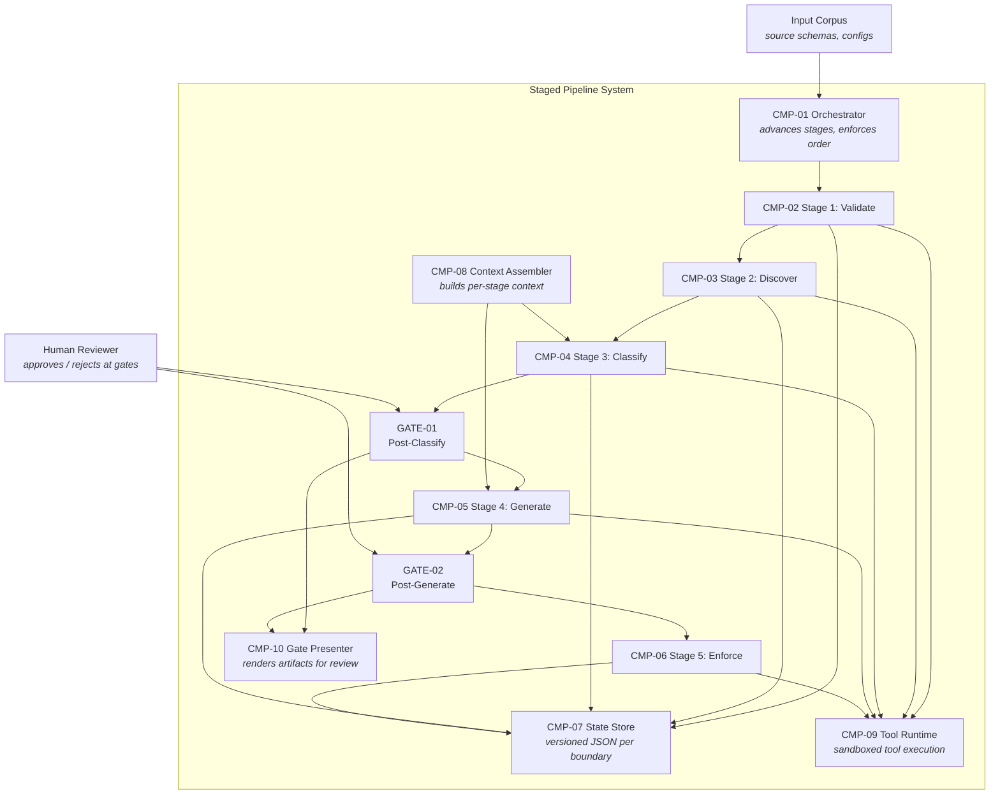
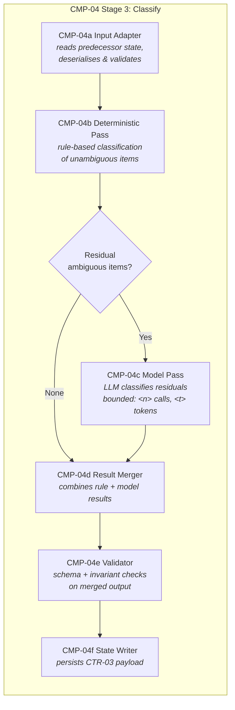
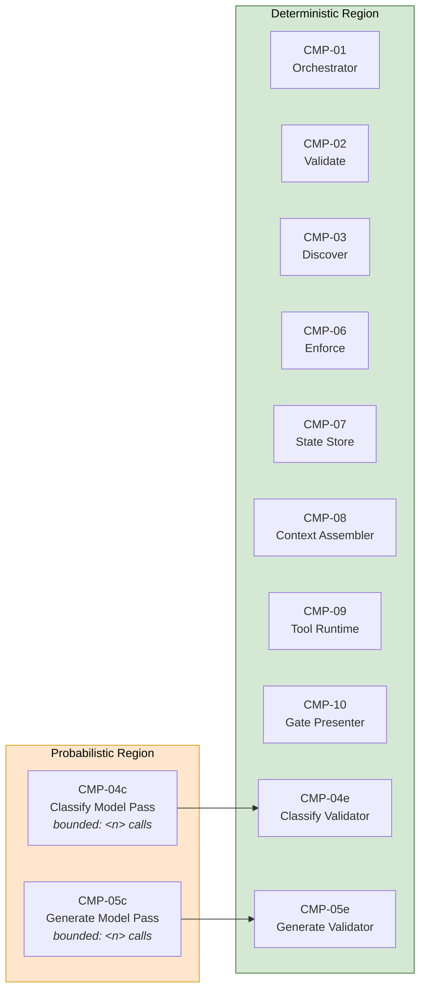
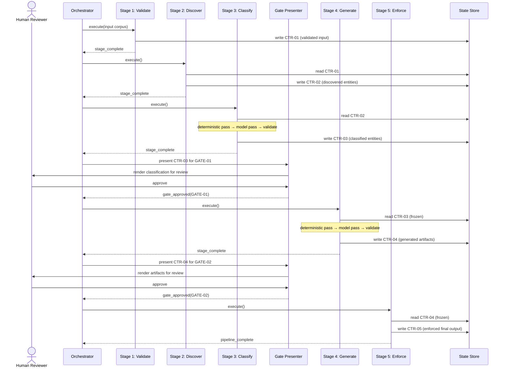
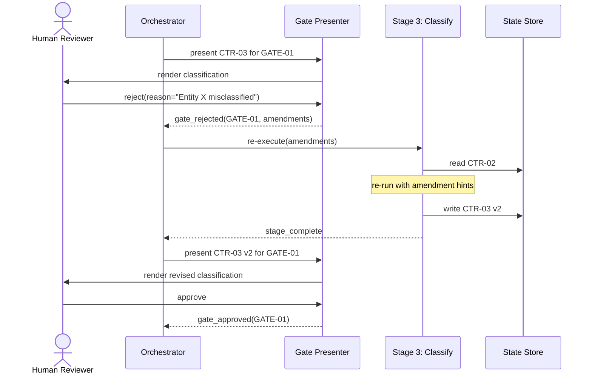
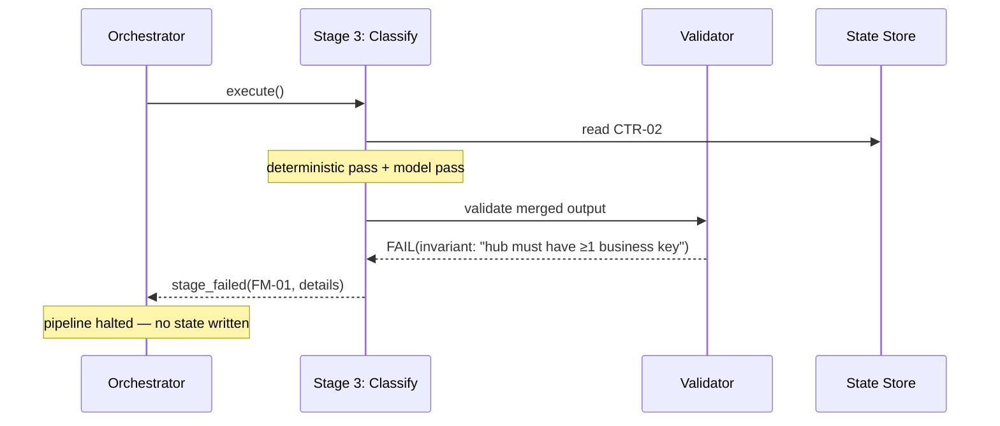
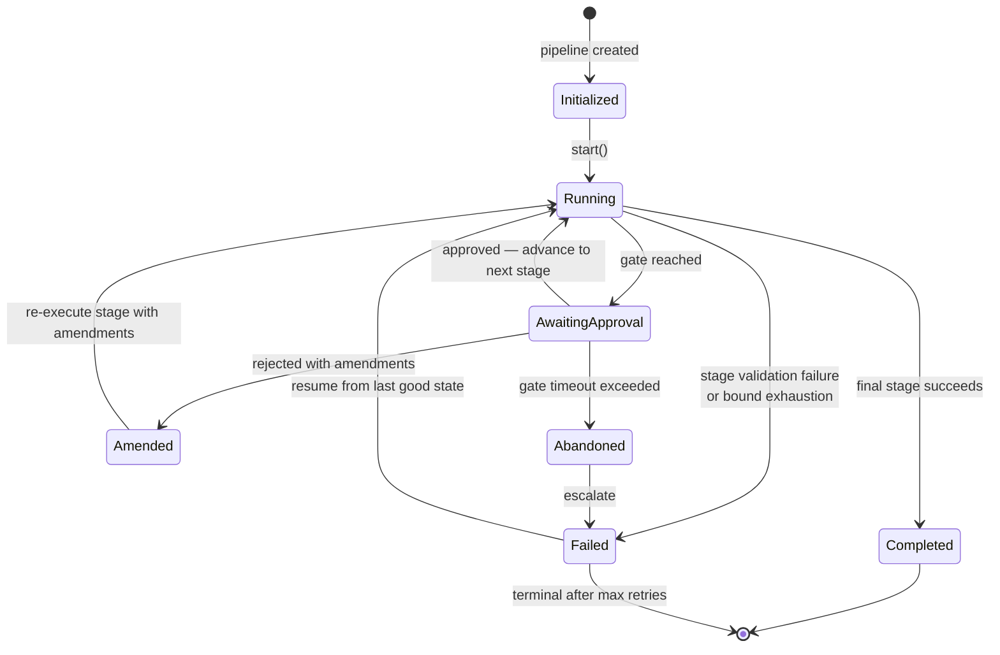
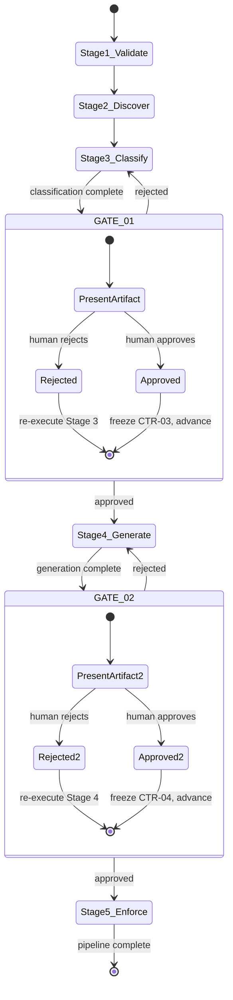

# Pattern 01 — Staged / Gated Pipeline

| Field | Value |
|---|---|
| Pattern ID | `PAT-01` |
| Name | Staged / Gated Pipeline |
| Autonomy level | Lowest — fixed path, known at design time |
| Pre-fills LLD sections | §4, §5 tables, §5a.1, §5a.3, §5a.5, §6, §8.3, §11.1 |
| Sources | Hohpe & Woolf (pipeline, process manager); Nygard (timeout, circuit breaker); Anthropic _Building Effective Agents_ (prompt chaining); Gamma et al. (pattern form) |

---

## 0. DDLC Agent Studio Runtime Mapping

- **Catalog Pattern ID**: `PAT-01` -> `agent.yaml` `architecture.pattern: "stateful_pipeline_with_gates"` (referenced in ADRs as `staged_gated`).
- **Recommended Runtime**: `architecture.runtime: "langgraph"` when cyclic reflection loops (`on_error` / `route_dry_run`) or `human_required` `interrupt()` gates backed by `PostgresSaver` are required (see `ADR-001` and `dbt_pipeline_builder_agent`). Use `python_litellm` only for linear, stateless two-pass CLI/webhook pipelines with no human gates (`ADR-003`).
- **Key Implementation Primitives**: Claim Check pointers (`storage_mode: claim_check`, `DbtArtifactBundle` with `artifact_sha256`) keep `AgentState` sub-kilobyte; multi-way `route_review` enforces frozen `ReviewedArtifactBundle` prior to fail-fast `node_deliver_stage` (Decisions 22, 27, 30).

---

## 1. Intent and applicability

**Intent.** Decompose an agentic workflow into a fixed, ordered sequence of stages connected by schema-validated state contracts, where each stage performs a bounded unit of work, writes its output to a durable store, and control advances only when the output passes validation — and, at designated points, only when a human approves.

**Use this pattern when:**

- The processing steps are known at design time and their order does not vary per input.
- The output enters a system of record, a regulated artifact store, or a downstream consumer that requires auditability and reproducibility.
- At least one step produces an irreversible side effect or a judgement for which a human must be accountable.
- Cost predictability matters — each run must be boundable in time, tokens, and tool calls before it starts.
- Post-incident forensics must reconstruct exactly what happened at each stage without re-running.

**Do not use this pattern when:**

- The step sequence genuinely varies per input and encoding the variation would mean a combinatorial explosion of branches — use orchestrator-workers (`PAT-02`) or ReAct (`PAT-05`) instead.
- The primary value comes from iterative refinement of a draft against a quality rubric — use evaluator-optimizer (`PAT-03`).
- Multiple specialists must contribute opportunistically with no predetermined order — use blackboard (`PAT-04`).

---

## 2. Problem and forces

A system must produce auditable, reproducible artifacts by applying a known sequence of transformations — validation, discovery, classification, generation, enforcement — to an input corpus. Several forces are in tension:

| Force | Tension |
|---|---|
| **Auditability vs. adaptability** | Full audit trail requires deterministic, recorded steps; adaptability requires the freedom to skip, reorder, or invent steps at runtime. This pattern resolves in favour of auditability. |
| **Determinism vs. coverage** | Pure rule-based stages miss edge cases that require judgement; pure model-based stages are non-reproducible. The two-pass design (rules first, model on residuals) addresses the tension without conceding either extreme. |
| **HITL friction vs. accountability** | Every gate slows the pipeline and requires human availability; omitting gates means no human has reviewed an artifact before it becomes authoritative. Gate placement must be selective, not reflexive. |
| **Resumability vs. simplicity** | A pipeline that must restart from scratch on any failure is operationally unacceptable at scale; a pipeline that can resume from any point requires durable, versioned state at every boundary. |
| **Bounded cost vs. completeness** | Strict budgets may truncate useful work; unbounded budgets expose the organisation to runaway spend on a single run. |

> **Why a pipeline beats an autonomous agent when the steps are known.** An autonomous agent discovers its plan at runtime — each model call decides the next action. That discovery is expensive, non-reproducible, and hard to audit. When the steps are already known, paying for the agent to rediscover them on every run is pure waste, and the non-determinism it introduces is pure risk. A pipeline encodes the known plan once in code, executes it repeatably, and confines model inference to the narrow sub-steps where rules genuinely cannot decide.

---

## 3. Structure (C4 Level 2 and Level 3)

### 3.1 C4 Level 2 — System context and containers



### 3.2 C4 Level 3 — Inside a representative stage (Stage 3: Classify)



> The two-pass structure is the defining internal shape of this pattern. Deterministic rules handle the majority of items; the model handles only the residual ambiguity. The validator sits between the model and any persistence, ensuring no unchecked probabilistic output reaches the state store.

---

## 4. Participants

| ID | Name | Responsibility | Determinism class |
|---|---|---|---|
| `CMP-01` | Orchestrator | Advances stages in fixed order and enforces pre-/post-conditions | Deterministic |
| `CMP-02` | Stage 1: Validate | Confirms input corpus is structurally well-formed | Deterministic |
| `CMP-03` | Stage 2: Discover | Extracts entities and relationships from validated input | Deterministic |
| `CMP-04` | Stage 3: Classify | Assigns domain classifications to discovered entities | Hybrid (two-pass) |
| `CMP-05` | Stage 4: Generate | Produces output artifacts from classified entities | Hybrid (two-pass) |
| `CMP-06` | Stage 5: Enforce | Applies deterministic policy rules and emits final artifacts | Deterministic |
| `CMP-07` | State Store | Persists versioned JSON state at each stage boundary | Deterministic |
| `CMP-08` | Context Assembler | Builds bounded context windows for model-invoking stages | Deterministic |
| `CMP-09` | Tool Runtime | Executes tool calls in a sandboxed environment | Deterministic |
| `CMP-10` | Gate Presenter | Renders gate artifacts for human review | Deterministic |

> Every participant that is classified Hybrid must declare in §5 exactly which sub-step is probabilistic, its bound, and its validator. "Hybrid" is a decomposition prompt, not a resting place.

---

## 5. Determinism boundary

The key architectural property of this pattern: **the probabilistic region is deliberately minimal**. Model inference occurs only inside the Model Pass sub-step of one or two stages, and every model output passes through a deterministic validator before reaching the state store. The majority of the pipeline — orchestration, validation, discovery, enforcement, all state I/O — is fully deterministic.

### 5.1 Two-pass design

1. **Deterministic pass** — rules classify or generate for all items where the mapping is unambiguous. Typical coverage: 70-90% of items.
2. **Model pass** — the LLM handles only residual items the deterministic pass could not decide. Bounded by call count and token budget. Output is merged with the deterministic results and validated before persistence.

This means a model failure or budget exhaustion degrades coverage but never corrupts the deterministic baseline.

### 5.2 Boundary diagram



> **Correspondence to VP-AGENTIC MK-1.** Every `CMP-` is classified. Every probabilistic component names its bound and validator. No probabilistic output reaches a write without passing through a deterministic validator. This is the trust-boundary trace that MK-1 requires.

---

## 6. Runtime behaviour

### 6.1 Happy path — full pipeline with gates



### 6.2 Gate rejection path



### 6.3 Stage validation failure path



### 6.4 Lifecycle state machine



---

## 7. State contracts

State contracts are the defining mechanism of this pattern. Every stage boundary is a schema-validated checkpoint. The rules:

1. **One `CTR-` per stage boundary.** Each contract is a versioned JSON schema. The schema version is embedded in the payload.
2. **Validate on both write and read.** The producing stage validates before writing; the consuming stage validates after reading. Double validation catches contract version skew and store corruption.
3. **A stage reads only its immediate predecessor's contract — no reaching back.** Stage 4 reads `CTR-03`, never `CTR-01` or `CTR-02`. This prevents hidden coupling, makes the stage independently testable, and makes resume semantics well-defined: to resume from Stage N, you need only `CTR-(N-1)`.
4. **Frozen on gate approval.** Once a human approves a gate, the contract payload behind that gate becomes immutable. Downstream stages may read it but never modify it.

### 7.1 Contract registry

| Contract | Boundary | Schema version | Producer | Consumer | Frozen by |
|---|---|---|---|---|---|
| `CTR-01` | Input → Validate | `1.0` | `CMP-02` | `CMP-03` | — |
| `CTR-02` | Validate → Discover | `1.0` | `CMP-03` | `CMP-04` | — |
| `CTR-03` | Discover → Classify | `1.0` | `CMP-04` | `CMP-05` | `GATE-01` |
| `CTR-04` | Classify → Generate | `1.0` | `CMP-05` | `CMP-06` | `GATE-02` |
| `CTR-05` | Generate → Enforce (final) | `1.0` | `CMP-06` | External consumers | — |

### 7.2 Example contract payload (`CTR-03`)

```json
{
  "contract_id": "CTR-03",
  "schema_version": "1.0",
  "run_id": "run-20260401-001",
  "produced_by": "CMP-04",
  "produced_at": "2026-04-01T14:23:07Z",
  "frozen_by_gate": null,
  "entities": [
    {
      "entity_id": "ent-017",
      "name": "CUSTOMER",
      "classification": "hub",
      "confidence": 1.0,
      "classified_by": "deterministic_pass"
    },
    {
      "entity_id": "ent-042",
      "name": "CUSTOMER_PREFERENCE",
      "classification": "satellite",
      "confidence": 0.87,
      "classified_by": "model_pass",
      "model_run_id": "mrun-04-003"
    }
  ],
  "summary": {
    "total_entities": 58,
    "deterministic_count": 51,
    "model_count": 7,
    "validation_passed": true
  }
}
```

> **Correspondence to VP-AGENTIC MK-6.** The `classified_by` field in every entity enables a reproducibility partition: deterministic-pass items are byte-identical across runs; model-pass items are not. The hash manifest (§11) covers the deterministic partition only.

---

## 8. Bounds, budgets and termination

### 8.1 Termination guarantee

Termination is **structural**. The pipeline has a finite, fixed list of stages known at compile time. There are no loops, no dynamic stage insertion, and no model-decided branching. This is the pattern's principal advantage over any agent-based alternative: the maximum number of steps is a design-time constant, not a runtime variable.

### 8.2 Per-stage bounds

| Bound | Stage 1 | Stage 2 | Stage 3 | Stage 4 | Stage 5 |
|---|---|---|---|---|---|
| Wall-clock timeout | 60 s | 120 s | 300 s | 300 s | 60 s |
| Tool call budget | 10 | 50 | 20 | 30 | 10 |
| Model calls (probabilistic sub-step) | 0 | 0 | `<n>` | `<n>` | 0 |
| Token budget (input + output) | 0 | 0 | `<t>` tokens | `<t>` tokens | 0 |
| Max model iterations on a single item | — | — | 1 | 1 | — |

> Stages 1, 2, and 5 have zero model budget. They are purely deterministic and cannot incur inference cost. Stages 3 and 4 have explicit, finite model call and token caps. Exhausting the cap is a graceful degradation (`FM-03`), not a crash.

### 8.3 Gate timeouts

| Gate | Timeout | On expiry |
|---|---|---|
| `GATE-01` | 48 h | Escalate to `FM-04` (gate abandonment) |
| `GATE-02` | 48 h | Escalate to `FM-04` |

> **Correspondence to VP-AGENTIC MK-3 / MK-4.** The bounds table satisfies MK-3 (tool authority per phase) and MK-4 (context budget per phase). Every phase has an enumerated budget; no phase has unbounded authority.

---

## 9. Human-in-the-loop gate placement

### 9.1 Placement doctrine

Place a gate after any stage that:

- Produces an **irreversible artifact** (deployed code, committed record, sent notification).
- Produces a **judgement a human is accountable for** (classification, risk rating, approval recommendation).
- Produces a **decision expensive to reverse** (schema migration, large-scale data transformation).

Do not place a gate after purely mechanical stages (input validation, deterministic formatting) — doing so adds friction without adding accountability.

### 9.2 Gate contract table

| Gate ID | After stage | Artifact presented | Permitted decisions | State frozen on approval | Freeze reversible? |
|---|---|---|---|---|---|
| `GATE-01` | Stage 3: Classify | Entity classification table with confidence scores and `classified_by` provenance | Approve / Reject with amendments / Escalate | `CTR-03` | No — downstream stages read from frozen `CTR-03` |
| `GATE-02` | Stage 4: Generate | Generated output artifacts with diff against prior baseline (if any) | Approve / Reject with amendments / Approve with exceptions | `CTR-04` | No — enforcement stage reads from frozen `CTR-04` |

> **The freeze clause is the substance of the gate** (MK-5). Without it, downstream stages could silently mutate what the human approved, and the gate would provide no guarantee. The frozen contract must be immutable in the state store — enforced by a write-protection mechanism, not by convention alone.

### 9.3 Resume-from-gate semantics

When a gate rejects:

1. The orchestrator records the rejection reason and any amendments in the run log.
2. The preceding stage is re-executed with the amendments available as input hints.
3. A new version of the contract is produced and presented at the same gate.
4. The loop is bounded: after `<n>` rejections at the same gate, the pipeline transitions to `Failed` and requires operator intervention.

### 9.4 Gate placement state diagram



---

## 10. Failure modes

| FM ID | Failure mode | Detection | Response | Severity |
|---|---|---|---|---|
| `FM-01` | **Stage validation failure** — merged output fails schema or invariant checks | Validator rejects payload; no state written | Pipeline halts at the failing stage. Operator inspects the validation error, corrects input or configuration, and resumes from the preceding contract. | High |
| `FM-02` | **Contract version skew** — consumer expects schema v1.1 but reads v1.0 | Read-side schema validation rejects on version mismatch | Pipeline halts. Operator aligns contract versions and resumes. Prevented by pinning schema versions in the pipeline manifest and deploying atomically. | High |
| `FM-03` | **Bound exhaustion in probabilistic sub-step** — model call or token budget exhausted before all residual items classified | Budget counter reaches limit; remaining items tagged `unclassified` | Stage completes with partial model coverage. Deterministic-pass results are preserved. The `summary.model_count` field reflects the shortfall. Gate reviewer decides whether coverage is acceptable. | Medium |
| `FM-04` | **Gate abandonment** — human never responds within timeout | Gate timeout timer expires | Pipeline transitions to `Abandoned → Failed`. Notification sent to escalation channel. Run can be resumed if reviewer responds later. | Medium |
| `FM-05` | **Partial artifact emission** — stage crashes after writing some but not all output | State writer uses atomic write (transaction or write-then-rename); partial writes are not visible | On crash, the incomplete contract is absent from the store. Stage is retried from the predecessor contract. Idempotent stage design is required. | High |
| `FM-06` | **Resume from stale state** — operator resumes a failed pipeline, but upstream data has changed since the original run | Hash manifest comparison between stored contract and current source detects drift | Pipeline refuses to resume and requires a fresh run from Stage 1. Prevents silent inconsistency between early and late stages. | Medium |
| `FM-07` | **Vacuous success** — stage produces a structurally valid contract with semantically empty payload (e.g., zero entities discovered) | Invariant checks beyond schema validation: `entity_count > 0`, business-rule minimum thresholds | Pipeline halts with `FM-07`. A schema-only validator would miss this; invariant validators must encode domain expectations, not just structure. | Medium |

> Failure modes `FM-01` through `FM-07` map directly to LLD §11.1 risk entries. Each must have a corresponding `RISK-` in the LLD and a test case in the eval harness.

---

## 11. Observability and eval strategy

### 11.1 Observability

| Signal | Granularity | Implementation |
|---|---|---|
| **Trace span** | One span per stage, child spans for sub-steps (deterministic pass, model pass, validation) | OpenTelemetry spans with `gen_ai.*` semantic conventions for model calls |
| **Verdict metric** | Per stage: `pass` / `fail` / `partial` | Emitted as a span attribute and as a counter metric |
| **Contract write event** | Per boundary | Structured audit log entry: `run_id`, `contract_id`, `schema_version`, `hash`, `timestamp` |
| **Gate decision event** | Per gate | Structured audit log entry: `gate_id`, `decision`, `reviewer`, `reason`, `frozen_contract_hash`, `timestamp` |
| **Model call log** | Per model invocation | Structured audit log entry: `input_hash`, `output_hash`, `tool_calls`, `token_counts`, `latency`, `model_version` |
| **Budget consumption** | Per stage | Running totals of tool calls, model calls, tokens consumed vs. budget |

### 11.2 Eval strategy

Because the pipeline is predominantly deterministic, **exact assertions dominate the eval suite**. This is a direct consequence of the pattern's design and its primary advantage for testing.

| Eval type | ID prefix | What it covers | Method |
|---|---|---|---|
| **Contract conformance** | `EV-01..` | Every `CTR-` payload passes its JSON schema and invariant checks | Automated: feed known input, assert output schema + invariants |
| **Deterministic stage regression** | `EV-02..` | Stages 1, 2, 5 produce byte-identical output on identical input | Automated: run twice, compare output hashes |
| **Reproducibility (hash manifest)** | `EV-03..` | All deterministic-pass items across all stages produce identical hashes across runs | Automated: run twice with pinned model version, compare hash manifest for deterministic partition |
| **Model-pass quality** | `EV-04..` | Classification accuracy on labelled residual items | Scored: compare model-pass outputs against a gold-label set; track precision/recall per class |
| **Gate guarantee verification** | `EV-05..` | Frozen contract is genuinely immutable downstream | Automated: attempt write to frozen contract after gate approval; assert rejection |
| **Failure mode coverage** | `EV-06..` | Each `FM-` triggers correctly and produces the documented response | Automated: inject fault (schema mismatch, budget exhaustion, timeout); assert documented behaviour |
| **End-to-end golden run** | `EV-07..` | Full pipeline on a reference input produces expected final contract | Automated: compare `CTR-05` against golden snapshot |

> **Correspondence to VP-AGENTIC MK-6.** The reproducibility claim for this pattern is: *given identical input, identical pipeline version, and identical model version, all deterministic-pass items produce byte-identical output, verified by hash manifest comparison.* Model-pass items are explicitly excluded from the reproducibility claim and tracked separately by `EV-04`.

---

## 12. Consequences, variants and anti-patterns

### 12.1 Positive consequences

| Consequence | Why |
|---|---|
| **Byte-identical reproducibility** for the deterministic partition | Fixed stages, deterministic tools, schema-validated state — identical input yields identical output for all rule-decided items |
| **Structural termination guarantee** | Finite stage list with no loops — maximum steps is a compile-time constant |
| **Per-stage failure isolation** | A failure in Stage 3 does not corrupt Stage 2's output; resume is always well-defined |
| **Full audit trail** | Every boundary has a persisted, hashed contract; every gate has a recorded human decision with timestamp and reason |
| **Cost predictability** | Per-stage budgets make worst-case run cost calculable before execution |

### 12.2 Negative consequences

| Consequence | Mitigation |
|---|---|
| **Rigidity** — the stage sequence is fixed; adapting to a new kind of input requires a pipeline change, not a prompt change | Accept this as a feature, not a bug, for regulated outputs. For exploratory work, use a different pattern. |
| **HITL latency** — gates block the pipeline until a human responds; asynchronous reviewers add hours or days | Gate timeout with escalation (`FM-04`); batch multiple runs for a single review session where the domain permits |
| **Poor fit when step sequence varies** — encoding per-input variation as conditional branches in the pipeline leads to combinatorial complexity | If variation exceeds a few conditional paths, switch to orchestrator-workers (`PAT-02`) |
| **Over-engineering for simple tasks** — a five-stage gated pipeline for a task that needs two deterministic steps is architectural overhead | Scale down: use fewer stages; omit gates if no irreversible artifact is produced. The pattern is a shape, not a minimum size. |

### 12.3 Variants

| Variant | Description | When to use |
|---|---|---|
| **Pipeline with parallel fan-out stage** | One stage fans out across independent input partitions (e.g., per source system), executes in parallel, and a merge sub-step consolidates results before the next stage | Input is naturally partitioned and partitions are independent; latency of sequential processing is unacceptable |
| **Pipeline with baseline-diff mode** | Each stage compares its output against a prior run's contract and emits only the delta | Incremental processing of evolving inputs; reduces gate review burden to changed items only |
| **Pipeline with optional deploy stage** | A final stage applies generated artifacts to a target environment, gated separately | The pipeline's output is executable (DDL, config, code) and must be deployed as part of the workflow |

### 12.4 Anti-patterns

| Anti-pattern | Why it fails |
|---|---|
| **Stage reaching back to earlier state** — Stage 4 reads `CTR-01` in addition to `CTR-03` | Creates hidden coupling between non-adjacent stages. Breaks resume semantics: resuming from Stage 4 now requires `CTR-01` to still be valid. Breaks independent testability. If Stage 4 needs data from Stage 1, that data must flow forward through intermediate contracts. |
| **Gate with no freeze clause** — gate approves but downstream stages can modify the approved payload | The gate provides no guarantee. The human's approval is meaningless if what they approved can be silently changed. This is a conformance failure against MK-5. |
| **LLM used for work a rule could do** — model classifies items that have an unambiguous rule-based mapping | Wastes budget, introduces nondeterminism, and degrades reproducibility for no gain. The two-pass design exists to prevent this: deterministic pass first, model only on genuine residuals. |
| **Validation that checks only schema** — validator confirms JSON structure but not domain invariants | Permits vacuous success (`FM-07`). A hub with zero business keys passes schema validation but is semantically invalid. Validators must encode domain expectations. |
| **Unbounded gate retry loop** — rejected gate re-executes the stage indefinitely | Must be bounded. After `<n>` rejections, transition to `Failed`. Unbounded retry is an implicit infinite loop. |
| **Monolithic stage with no internal decomposition** — a single stage does rule-based work, model work, and validation in an opaque function | Prevents the determinism boundary from being drawn (MK-1 violation). The two-pass + validator internal structure must be visible and separately testable. |
