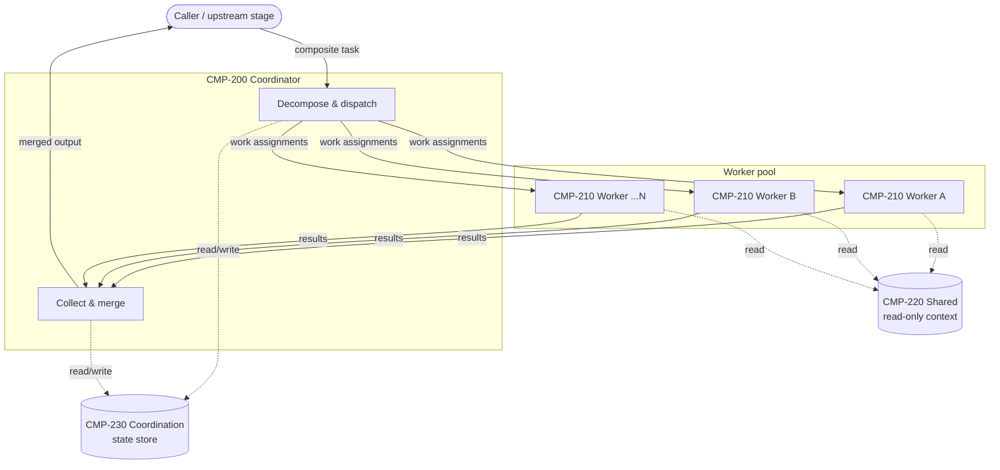
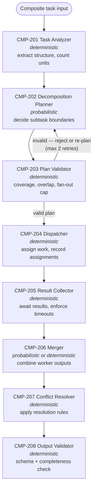
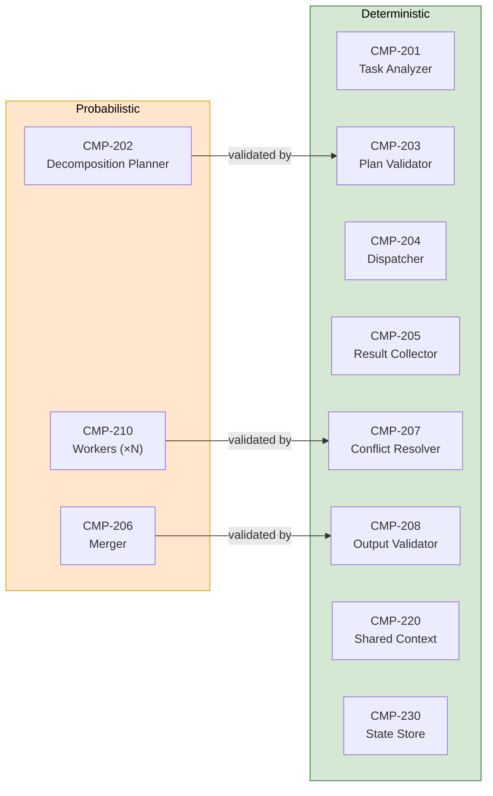
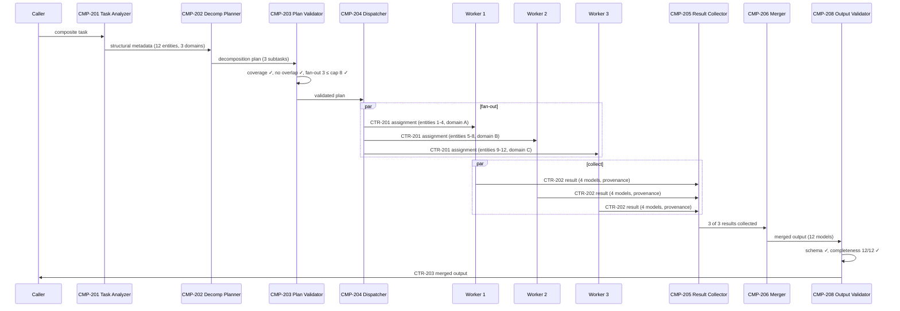
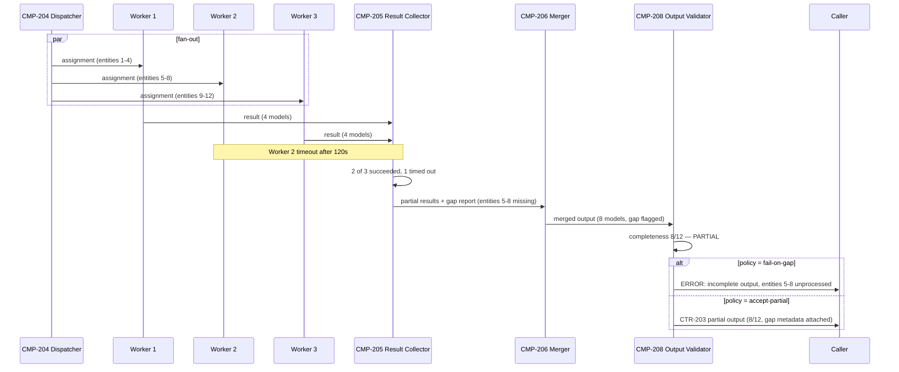
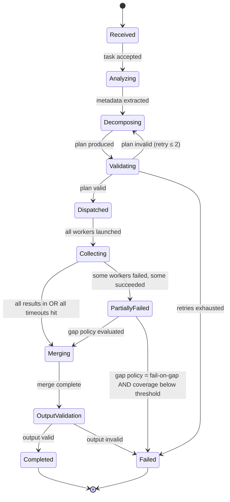
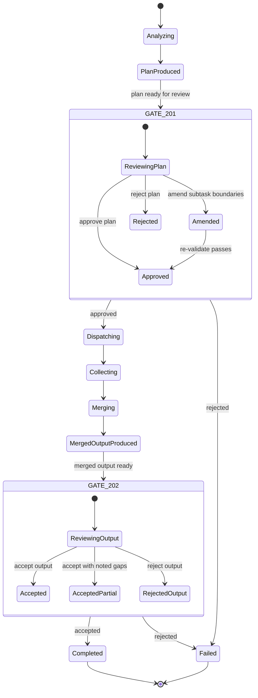

# Pattern 02 — Orchestrator + Workers

| Field | Value |
|---|---|
| Pattern ID | `PAT-02` |
| Name | Orchestrator + Workers (Coordinator / Dispatcher / Scatter-Gather) |
| Autonomy level | Medium — path chosen at runtime by coordinator; workers execute independently |
| Pre-fills LLD sections | §4, §5.1, §5.2, §5a.1, §5a.3, §5a.5, §6, §11.1 |
| Sources | Anthropic *Building Effective Agents* (2024); Hohpe & Woolf *Enterprise Integration Patterns* (scatter-gather, splitter/aggregator); Nygard *Release It!* (timeout, bulkhead) |

---

## 0. DDLC Agent Studio Runtime Mapping

- **Catalog Pattern ID**: `PAT-02` -> implemented on `architecture.runtime: "langgraph"` using parallel fan-out dispatch (`Send` / dynamic worker subgraphs) and deterministic plan validation (`CMP-203`) before worker execution.
- **When to Prefer `PAT-01` Instead**: If subtask decomposition is static and known at design time (e.g., fixed schema discovery or fixed per-source onboarding), prefer `stateful_pipeline_with_gates` (`PAT-01`) for full reproducibility and lower coordination cost.
- **Key Implementation Primitives**: Map `MAX_WORKERS`, `WORKER_TIMEOUT_MS`, and `TOTAL_RUN_BUDGET` directly to `stages[].processing.safety_valves` and `llm_config.cost_cap_usd`; enforce `Output Validator` (`CMP-208`) Pydantic validation on the merged contract before any `human_review` gate or `delivery` node.

---

## 1. Intent and applicability

**Intent.** A coordinator receives a composite task, decides at runtime how to decompose it into independent subtasks, dispatches those subtasks to a pool of workers (often in parallel), collects their results, and merges them into a single output. The distinguishing feature is that the decomposition itself is not knowable at design time — it is a model decision.

**When to apply.**

- The work is decomposable into subtasks that are independent of one another once assigned.
- The decomposition cannot be determined statically — it depends on the content, size, or structure of each input.
- Parallelism across subtasks yields a meaningful throughput or latency benefit.
- Each subtask is self-contained: a worker needs only its assignment and shared read-only context, not the results of other workers.

**When NOT to apply.**

- The decomposition is known at design time. Use a staged pipeline (`PAT-01`) with a parallel fan-out stage instead — it is cheaper to build, cheaper to run, and fully reproducible.
- Subtasks must share mutable state or agree with each other during execution. The orchestrator-workers pattern assumes independence; violating that assumption means you are building distributed consensus without the machinery for it.
- A single subtask's output depends on another subtask's output. That is a dependency graph, not a fan-out.
- The merge is trivial concatenation and the decomposition is a deterministic split (e.g. chunk-by-byte-offset). That is a map-reduce, not an agentic orchestration — use conventional parallelism.

---

## 2. Problem and forces

| Force | Tension |
|---|---|
| Throughput vs coordination cost | Parallel workers reduce wall-clock time, but the coordinator adds latency, token spend, and a failure point. |
| Dynamic decomposition vs reproducibility | Runtime decomposition adapts to input; it also means two runs on the same input may produce different plans and therefore different outputs. |
| Worker autonomy vs result consistency | Giving workers latitude improves individual subtask quality; it also means worker outputs may adopt incompatible formats, tones, or assumptions. |
| Partial success vs all-or-nothing | Some workers may succeed while others fail. Accepting partial results is often the pragmatic choice, but the merge must handle gaps without silently producing an incomplete artifact. |
| Fan-out breadth vs cost | Each additional worker multiplies token and compute cost linearly. An unbounded fan-out turns a variable-cost pattern into an open-ended liability. |

> The hardest problem in this pattern is not the fan-out. It is the merge. Merging N independent outputs into a coherent whole — handling conflicts, gaps, and schema drift — is where most implementations silently degrade.

---

## 3. Structure (C4 Level 2 and Level 3)

### 3.1 C4 Level 2 — Container diagram



### 3.2 C4 Level 3 — Component diagram (inside the Coordinator)



> The critical path through the coordinator is: analyze → plan → validate → dispatch → collect → merge → resolve → validate-output. The plan validator (`CMP-203`) is the mandatory deterministic checkpoint between the probabilistic decomposition and the expensive fan-out.

---

## 4. Participants

| ID | Name | Responsibility | Determinism |
|---|---|---|---|
| `CMP-200` | Coordinator | Owns the full decompose-dispatch-merge lifecycle for a single composite task. | Hybrid |
| `CMP-201` | Task Analyzer | Extracts structural metadata from the input (entity count, schema, size). | Deterministic |
| `CMP-202` | Decomposition Planner | Decides how to split the input into subtasks based on analyzed structure. | Probabilistic |
| `CMP-203` | Plan Validator | Checks the decomposition plan against coverage, overlap, and bound rules. | Deterministic |
| `CMP-204` | Dispatcher | Assigns validated subtasks to workers and records assignments in state store. | Deterministic |
| `CMP-205` | Result Collector | Awaits worker results, enforces per-worker timeouts, records outcomes. | Deterministic |
| `CMP-206` | Merger | Combines collected worker outputs into a single artifact. | Probabilistic or Deterministic (project-dependent) |
| `CMP-207` | Conflict Resolver | Applies deterministic resolution rules to conflicts detected during merge. | Deterministic |
| `CMP-208` | Output Validator | Validates the merged output against the expected schema and completeness. | Deterministic |
| `CMP-210` | Worker (pool member) | Executes a single subtask and returns a structured result with provenance. | Probabilistic |
| `CMP-220` | Shared Read-Only Context | Provides reference data accessible to all workers without mutation. | Deterministic |
| `CMP-230` | Coordination State Store | Persists assignments, statuses, and results for auditability and recovery. | Deterministic |

---

## 5. Determinism boundary

> Satisfies `VP-AGENTIC` MK-1 (Determinism Boundary Model) from `../templates/01-agentic-viewpoint.md` (LLD §5a.1).



**Two probabilistic boundaries exist in this pattern:**

1. **Decomposition** (`CMP-202`). The planner decides subtask boundaries. This is the highest-leverage probabilistic decision: a bad decomposition multiplies cost across every worker. The plan validator (`CMP-203`) must enforce deterministic rules before dispatch:
   - **Coverage** — every input unit is assigned to exactly one subtask.
   - **No overlap** — no input unit appears in more than one assignment.
   - **Bounded worker count** — the plan does not exceed the configured fan-out cap.
   - **Parseable assignments** — each subtask description conforms to the `CTR-201` schema.

2. **Per-worker reasoning** (`CMP-210`). Each worker applies model inference to its subtask. Worker outputs are collected and validated by the conflict resolver (`CMP-207`) and output validator (`CMP-208`) before the merged result is emitted.

The merger (`CMP-206`) may be deterministic (rule-based concatenation or structured assembly) or probabilistic (model-driven synthesis). If probabilistic, its output must flow through the output validator before any side effect — per MK-1 correspondence rule AG-CR-3.

---

## 6. Runtime behaviour

### 6.1 Happy-path sequence — fan-out and merge



### 6.2 Partial-worker-failure sequence



> The merge-with-holes decision is the hard case. The output validator must make the gap explicit in the response — never silently emit an incomplete artifact as if it were complete. The policy (fail-on-gap vs accept-partial) is a project-level configuration, not a runtime model decision.

### 6.3 Lifecycle state machine



---

## 7. State contracts

> Satisfies the `CTR-` set referenced in LLD §5a and §6.

### CTR-201 — Work Assignment (Coordinator → Worker)

| Field | Type | Description |
|---|---|---|
| `assignment_id` | string (UUID) | Unique identifier for this assignment. |
| `run_id` | string (UUID) | Parent run identifier for correlation. |
| `subtask_index` | integer | Position in the decomposition plan (0-based). |
| `subtask_count` | integer | Total number of subtasks in this run. |
| `input_slice` | object | The subset of the input assigned to this worker. |
| `input_slice.entity_ids` | array[string] | Explicit list of input unit identifiers assigned. |
| `input_slice.domain` | string | Domain or category label for the slice. |
| `shared_context_ref` | string (URI) | Pointer to the shared read-only context. |
| `output_schema_ref` | string (URI) | Pointer to the expected output JSON schema. |
| `timeout_ms` | integer | Per-worker timeout in milliseconds. |
| `token_budget` | integer | Maximum tokens this worker may consume. |
| `model_id` | string | Model identifier and version the worker must use. |

**Example payload:**

```json
{
  "assignment_id": "a7e3f1b2-04cc-4d9a-b5e1-9f8a2c3d4e5f",
  "run_id": "d1a2b3c4-5678-9abc-def0-1234567890ab",
  "subtask_index": 0,
  "subtask_count": 3,
  "input_slice": {
    "entity_ids": ["CUSTOMER", "CUSTOMER_ADDRESS", "CUSTOMER_PHONE", "CUSTOMER_EMAIL"],
    "domain": "customer_management"
  },
  "shared_context_ref": "state://runs/d1a2b3c4/context",
  "output_schema_ref": "schemas://worker_result_v2.json",
  "timeout_ms": 120000,
  "token_budget": 32000,
  "model_id": "claude-sonnet-4-20250514"
}
```

### CTR-202 — Worker Result (Worker → Coordinator)

| Field | Type | Description |
|---|---|---|
| `assignment_id` | string (UUID) | Echoed from the assignment for correlation. |
| `run_id` | string (UUID) | Parent run identifier. |
| `worker_id` | string | Identifier of the worker instance that executed. |
| `model_id` | string | Actual model identifier and version used. |
| `input_slice_hash` | string (SHA-256) | Hash of the input slice received, for integrity verification. |
| `status` | enum | `success`, `partial`, `error`. |
| `output` | object | The structured subtask result conforming to `output_schema_ref`. |
| `token_usage` | object | `{prompt_tokens, completion_tokens, total_tokens}`. |
| `duration_ms` | integer | Wall-clock execution time. |
| `error_detail` | string or null | Error message if status is not `success`. |

> Every worker result carries provenance: which worker, which input slice (by hash), which model version. This makes the merge auditable — a reviewer can trace any element in the merged output back to the specific worker invocation that produced it.

### CTR-203 — Merged Output (Coordinator → Caller)

| Field | Type | Description |
|---|---|---|
| `run_id` | string (UUID) | Parent run identifier. |
| `status` | enum | `complete`, `partial`, `failed`. |
| `completeness` | object | `{expected: N, received: M, gap_entities: [...]}`. |
| `output` | object | The merged result conforming to the caller's expected schema. |
| `provenance` | array[object] | Per-element trace: `{element_id, source_assignment_id, worker_id}`. |
| `aggregate_token_usage` | object | Sum of all worker token usage plus coordinator overhead. |
| `aggregate_duration_ms` | integer | Wall-clock time from task receipt to output emission. |
| `decomposition_plan_hash` | string (SHA-256) | Hash of the validated plan, for reproducibility analysis. |

---

## 8. Bounds, budgets and termination

> Satisfies MK-1 bounds and MK-3 (Tool Authority Model) from `../templates/01-agentic-viewpoint.md`.

| Bound | Scope | Example value | Rationale |
|---|---|---|---|
| `MAX_WORKERS` | Per run | 8 | Fan-out cap. The single most important bound — cost scales linearly with worker count. |
| `WORKER_TIMEOUT_MS` | Per worker | 120 000 (2 min) | Prevents straggler workers from blocking the entire run indefinitely. |
| `WORKER_TOKEN_BUDGET` | Per worker | 32 000 | Caps per-worker inference cost. |
| `TOTAL_RUN_BUDGET` | Per run | 200 000 tokens | Aggregate ceiling. Must be ≥ coordinator overhead + (MAX_WORKERS × WORKER_TOKEN_BUDGET). |
| `DECOMP_RETRIES` | Per run | 2 | Limits re-planning attempts if the plan validator rejects. |
| `COORDINATOR_TOKEN_BUDGET` | Per run | 16 000 | Budget for the coordinator's own inference (decomposition + merge). |
| `MERGE_TIMEOUT_MS` | Per run | 60 000 (1 min) | Prevents unbounded merge processing. |

**Termination guarantee.** Termination requires BOTH a finite worker count AND a per-worker bound. A finite fan-out with unbounded workers can still run forever. A bounded worker with unbounded fan-out can still exhaust the budget. Both constraints are necessary; neither is sufficient alone.

**The aggregate budget problem.** If `MAX_WORKERS` = 8 and `WORKER_TOKEN_BUDGET` = 32 000, then the worst-case worker spend alone is 256 000 tokens — before adding coordinator overhead. The `TOTAL_RUN_BUDGET` must account for this multiplication. A common error is setting per-worker budgets independently of the total, discovering the overrun only in production. Enforce the invariant at startup:

```
assert COORDINATOR_TOKEN_BUDGET + (MAX_WORKERS × WORKER_TOKEN_BUDGET) ≤ TOTAL_RUN_BUDGET
```

> The fan-out cap (`MAX_WORKERS`) is the highest-value bound in this pattern. Every other cost and latency metric is a function of it. Set it deliberately; never leave it uncapped.

---

## 9. Human-in-the-loop gate placement

> Satisfies MK-5 (Human Interaction Gate Model) from `../templates/01-agentic-viewpoint.md`.



### Gate contracts

| Gate | Placement | Artifact presented | Permitted decisions | State frozen on approval | Freeze reversible downstream? |
|---|---|---|---|---|---|
| `GATE-201` | After decomposition plan is validated, before dispatch | The decomposition plan: subtask list, assigned entities, worker count, estimated cost | Approve / Amend subtask boundaries / Reject | Decomposition plan, worker count, input-slice assignments | No — dispatch proceeds from the frozen plan |
| `GATE-202` | After merge and output validation | The merged output, completeness report, provenance trace, aggregate cost | Accept / Accept-with-gaps / Reject | Merged output artifact, provenance log | No — accepted artifact is the system-of-record version |

> `GATE-201` is the highest-value gate in this pattern. It is the cheapest point to catch a decomposition error — before any worker spends tokens. An error that passes this gate multiplies across every worker. In automation mode, this gate may be bypassed if the plan validator passes all deterministic checks and fan-out ≤ a pre-approved threshold (e.g. ≤ 4 workers). The bypass must be declared and cross-referenced in the LLD security section per MK-5 conventions.

---

## 10. Failure modes

| ID | Failure mode | Cause | Impact | Mitigation |
|---|---|---|---|---|
| `FM-201` | Bad decomposition — coverage gap | Planner omits input units from all subtasks. | Missing data in output, undetected if merge does not check completeness. | Plan validator (`CMP-203`) asserts coverage: every input unit assigned exactly once. |
| `FM-202` | Bad decomposition — overlap | Planner assigns the same input unit to multiple subtasks. | Duplicated or conflicting output elements. | Plan validator asserts no overlap; conflict resolver handles residual duplicates. |
| `FM-203` | Worker partial failure | One or more workers error or return malformed output. | Incomplete merge input. | Result collector records failures; gap policy determines whether to proceed or abort. |
| `FM-204` | Worker timeout (straggler) | A worker takes disproportionately longer than peers. | Blocks collection phase; delays total run. | Per-worker timeout (`WORKER_TIMEOUT_MS`); treat timeout as failure and apply gap policy. |
| `FM-205` | Tail latency / straggler effect | One slow worker dominates wall-clock time even when others finish quickly. | Reduced throughput benefit of parallelism. | Monitor per-worker duration; consider speculative re-dispatch for stragglers exceeding p90. |
| `FM-206` | Result schema divergence | Workers return outputs with incompatible structures or semantics. | Merger cannot combine results coherently. | Enforce `output_schema_ref` validation on each worker result before merge. |
| `FM-207` | Merge conflict — no resolution rule | Two workers produce contradictory outputs for overlapping concerns. | Undefined merge behaviour; silent data corruption. | Conflict resolver (`CMP-207`) must have explicit rules; fail loudly on unresolvable conflicts. |
| `FM-208` | Fan-out explosion | Planner produces a decomposition with excessive subtask count. | Cost overrun, resource exhaustion. | Plan validator enforces `MAX_WORKERS` cap; reject plans exceeding it. |
| `FM-209` | Non-idempotent worker retry | A timed-out worker is retried, but its first invocation completed a side effect. | Duplicated side effects (e.g. duplicate records created). | Design workers to be idempotent; use assignment IDs for deduplication; limit write authority. |
| `FM-210` | Cost overrun | Aggregate token usage exceeds `TOTAL_RUN_BUDGET`. | Unexpected spend; potential budget exhaustion. | Enforce aggregate budget invariant; monitor cumulative usage during collection. |
| `FM-211` | Coordinator doing worker work | Coordinator attempts to process subtasks itself instead of delegating. | Breaks parallelism: coordinator becomes a bottleneck and single point of failure. | Architectural enforcement: coordinator has no tool authority for subtask execution. |

---

## 11. Observability and eval strategy

### 11.1 Observability

> Aligns with OpenTelemetry GenAI semantic conventions referenced in `../templates/01-agentic-viewpoint.md` §9.

| Signal | Implementation | Purpose |
|---|---|---|
| Parent span | One trace span per run (`run_id`), enclosing all coordinator and worker spans. | Correlates the entire fan-out under one trace. |
| Worker child spans | One span per worker invocation, parented to the run span. Attributes: `assignment_id`, `worker_id`, `model_id`, `subtask_index`. | Per-worker latency, token usage, and status attribution. |
| Fan-out width metric | Gauge: number of workers dispatched per run. | Detects fan-out drift; alerting threshold at `MAX_WORKERS`. |
| Straggler detection | Timer: per-worker duration relative to peer p50. Alert if any worker exceeds 3x peer median. | Catches tail-latency issues before they block collection. |
| Per-worker cost attribution | Counter: `token_usage` broken down by `worker_id` and `model_id`. | FinOps attribution; identifies expensive workers. |
| Decomposition plan log | Structured log: the full validated plan, hashed, attached to the run span. | Post-hoc audit of what was dispatched and why. |
| Gap report | Structured log: entities not covered in the merged output, emitted on partial completion. | Incident forensics for incomplete outputs. |

### 11.2 Eval strategy

| ID | Eval case | Type | What it verifies |
|---|---|---|---|
| `EV-201` | Decomposition coverage assertion | Deterministic | Every input unit appears in exactly one subtask. Cheap, run on every invocation. |
| `EV-202` | Decomposition overlap assertion | Deterministic | No input unit appears in more than one subtask. Cheap, run on every invocation. |
| `EV-203` | Fan-out cap test | Deterministic | Worker count ≤ `MAX_WORKERS` for every plan produced. |
| `EV-204` | Per-worker output conformance | Deterministic | Each worker result validates against `output_schema_ref`. |
| `EV-205` | Merge correctness — element traceability | Deterministic | Every element in the merged output traces to exactly one worker result via provenance. |
| `EV-206` | Merge correctness — completeness | Deterministic | Element count in merged output equals sum of elements across worker results (minus conflicts). |
| `EV-207` | Partial-failure handling | Scenario | Inject a worker timeout; verify the gap is reported, not silently swallowed. |
| `EV-208` | Cost invariant | Deterministic | `coordinator_tokens + sum(worker_tokens) ≤ TOTAL_RUN_BUDGET`. |
| `EV-209` | Reproducibility baseline | Statistical | Run the same input 5 times with temperature 0; measure decomposition plan stability and output variance. |

> `EV-201` and `EV-202` are the highest-value evals in this pattern. They are deterministic, cheap, and catch the failure mode (`FM-201`, `FM-202`) that multiplies cost across every worker. Run them as assertions on every invocation, not as periodic batch evals.

---

## 12. Consequences, variants and anti-patterns

### 12.1 Consequences — positive

| Consequence | Detail |
|---|---|
| Throughput | Wall-clock time approaches the duration of the slowest worker, not the sum of all subtasks. |
| Adaptability | Decomposition adapts to input structure — a 5-entity input gets 2 workers; a 50-entity input gets 8. |
| Failure isolation | A single worker failure does not necessarily invalidate the entire run. |
| Auditability | Per-worker provenance in `CTR-202` and `CTR-203` enables element-level traceability. |
| Composability | Workers can internally use any pattern (`PAT-01` pipeline, `PAT-03` evaluator-optimizer) without affecting the coordinator. |

### 12.2 Consequences — negative

| Consequence | Detail |
|---|---|
| Reproducibility loss | Dynamic decomposition means the same input may be split differently across runs. Pinning the model and temperature reduces but does not eliminate this. |
| Cost variance | Token spend varies with fan-out width. Two runs on similar inputs may cost 2x or 0.5x each other. |
| Debugging complexity | A defect in the merged output requires tracing back through the merge, identifying the responsible worker, and inspecting that worker's input slice — a multi-hop investigation. |
| Merge semantics are the hidden complexity | The merge is where inconsistencies, gaps, and conflicts surface. Most teams underestimate the engineering effort here. |
| Coordination overhead | The coordinator itself consumes tokens and latency. For small inputs, the overhead may exceed the parallelism benefit. |

### 12.3 Variants

| Variant | Description | When to prefer |
|---|---|---|
| **Static fan-out** | Decomposition is deterministic (e.g. one worker per source system). Degenerates to a parallel stage in `PAT-01`. | When the decomposition IS knowable at design time. Always prefer this over dynamic decomposition if it fits. |
| **Hierarchical orchestration** | Coordinator dispatches to sub-coordinators, each of which fans out to its own workers. | Very large inputs where a single fan-out would exceed the cap. Adds a coordination layer; bound recursion depth. |
| **Routing-only (classify and dispatch)** | Coordinator classifies the input and routes to exactly one specialist worker. No merge — the specialist's output is the output. | When the task requires specialization, not decomposition. No fan-out cost, no merge complexity. |
| **Speculative dispatch** | Coordinator dispatches to multiple workers with overlapping assignments; uses the first (or best) result. | Latency-critical applications where redundancy is cheaper than tail-latency risk. Wastes tokens by design. |

### 12.4 Anti-patterns

| Anti-pattern | Why it fails |
|---|---|
| **Workers writing shared mutable state** | Violates the independence assumption. Produces race conditions the pattern has no concurrency control for. Use `PAT-04` (Blackboard) if shared state is genuinely needed. |
| **Unbounded fan-out** | Cost scales linearly with worker count. Without `MAX_WORKERS`, a pathological input can trigger an arbitrarily expensive run. |
| **Merge with no conflict rule** | When two workers produce contradictory outputs, the merge must have a deterministic resolution strategy. "Last writer wins" is a rule; having no rule is a bug. |
| **Coordinator doing worker work** | The coordinator should decompose, dispatch, and merge — not execute subtasks itself. A coordinator that also works becomes a bottleneck and loses the parallelism benefit. |
| **Dynamic decomposition where static would do** | If you can enumerate the subtasks at design time, use a pipeline. Dynamic decomposition adds cost, variance, and a failure mode for no benefit. |
| **Retry without idempotency** | Retrying a failed worker that already performed a side effect (wrote a record, called an API) duplicates the effect. Workers must be idempotent, or retries must be suppressed for workers with write authority. |
| **Trusting the plan without validation** | Dispatching the decomposition plan without running it through the plan validator means every downstream failure mode (`FM-201`, `FM-202`, `FM-208`) is unguarded. The plan validator is the cheapest control in the pattern — never skip it. |
