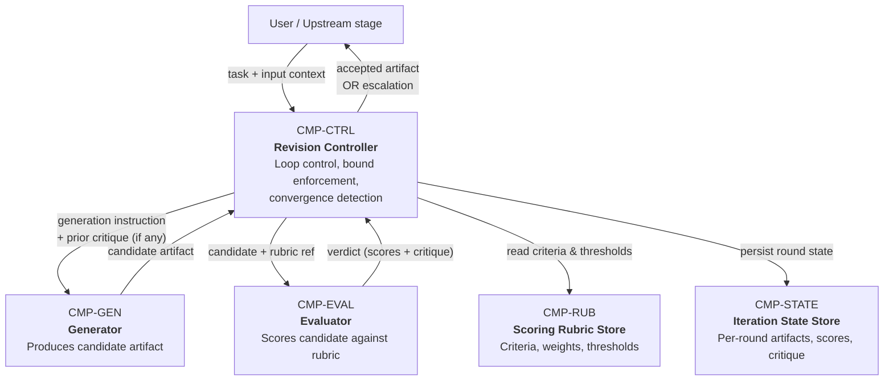
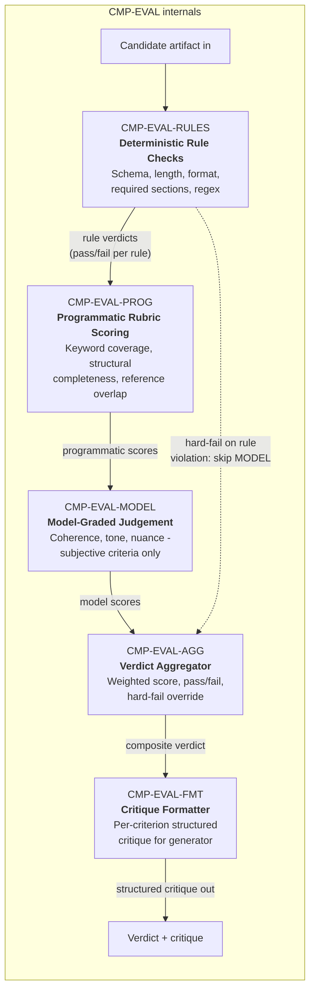
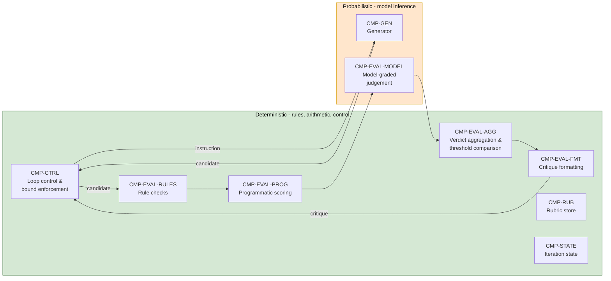
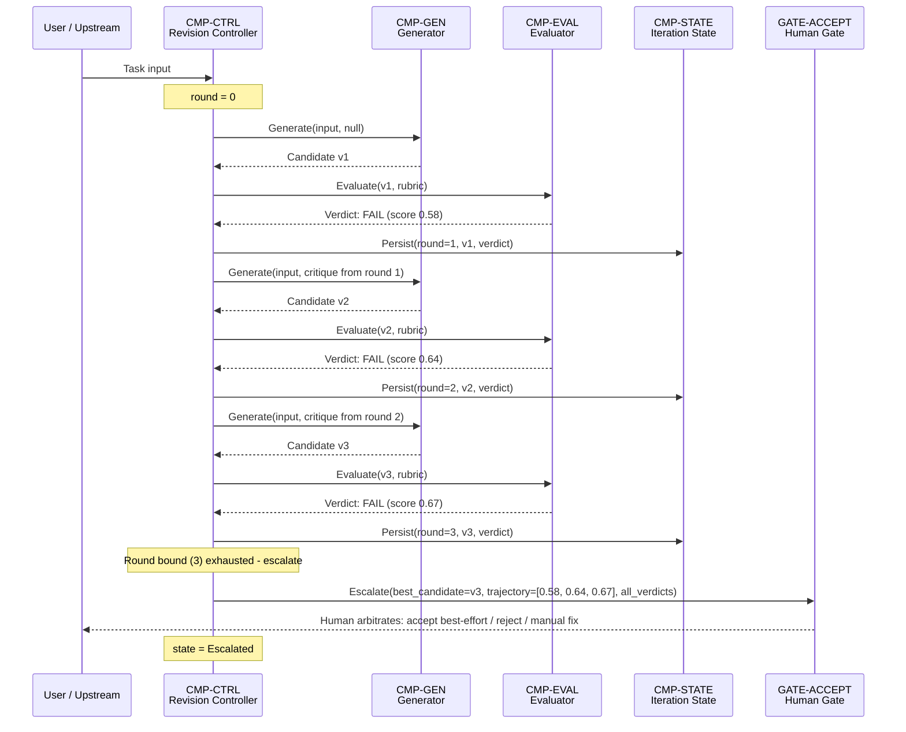
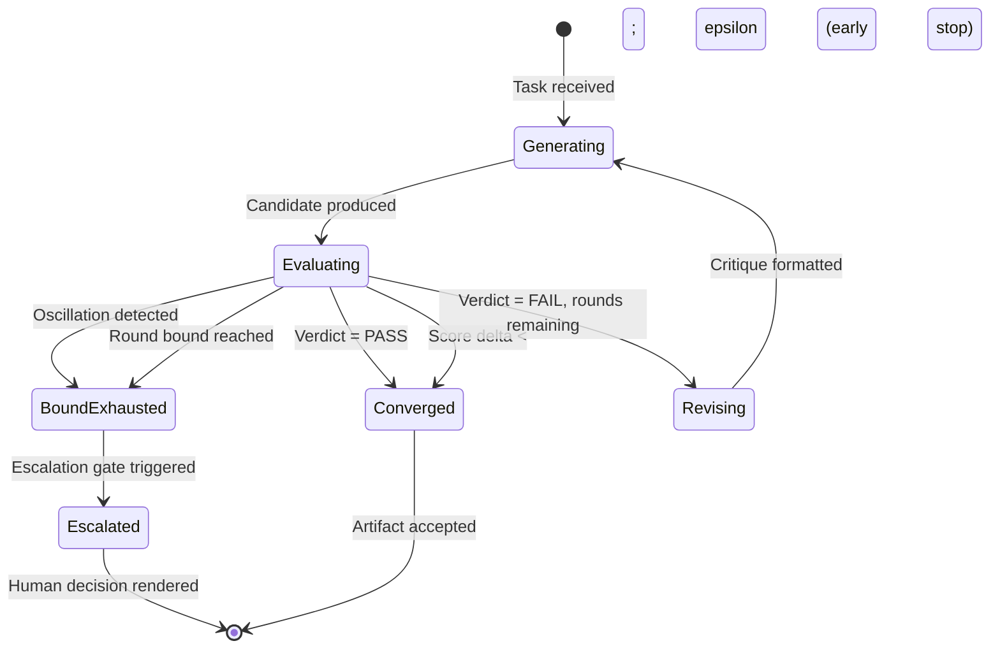
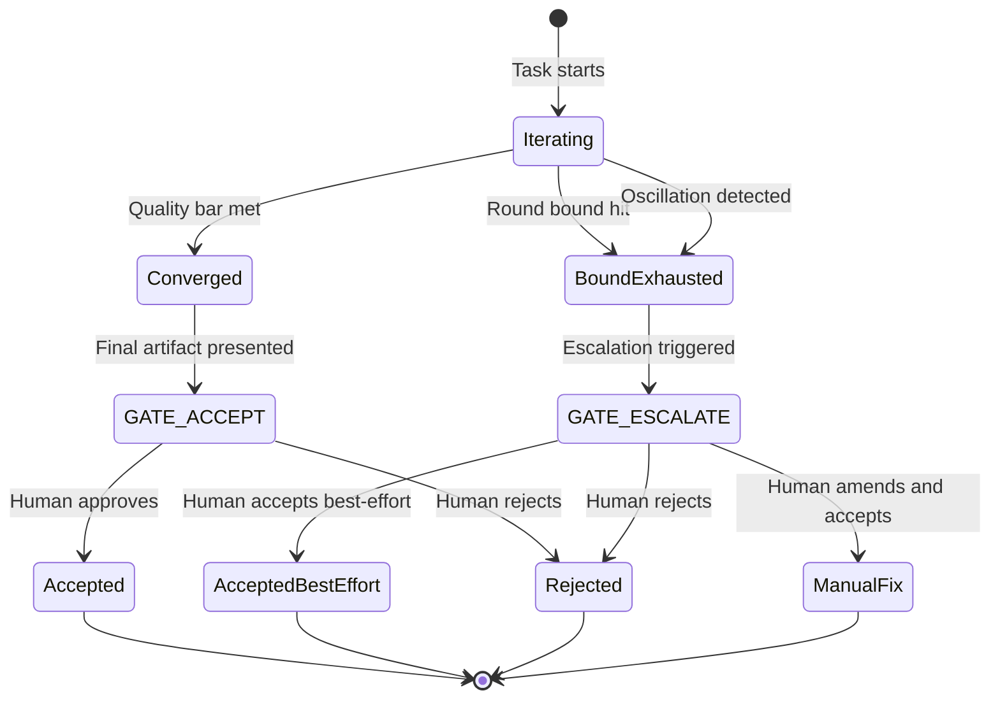

# Pattern 03 — Evaluator-Optimizer

| Field | Value |
|---|---|
| Pattern ID | `PAT-03` |
| Name | Evaluator-Optimizer |
| Autonomy level | Medium-low (fixed control flow with bounded iteration) |
| Pre-fills LLD sections | §4, §5.1, §5.2, §5a.1, §5a.3, §5a.5, §6, §8.3, §11.1 |
| Sources | Anthropic *Building Effective Agents* (2024); Zheng et al. *Judging LLM-as-a-Judge* (2023); Nygard *Release It!*; `../templates/01-agentic-viewpoint.md` MK-1 through MK-6 |

---

## 0. DDLC Agent Studio Runtime Mapping

- **Catalog Pattern ID**: `PAT-03` -> typically composed as a bounded self-correction sub-loop inside `langgraph` (`stateful_pipeline_with_gates` or `multi_step_planner_agent` in `agent.yaml`).
- **Canonical DDLC Usage**: The `generate` <-> `dry_run` reflection cycle in `dbt_pipeline_builder_agent` (`ADR-001`), where `dbt compile` + `sqlglot` AST verification act as a deterministic-only critic (`CMP-EVAL-RULES`) and `route_dry_run` enforces `safety_valves.max_reflection_retries: 3`.
- **Key Implementation Primitives**: Loop termination (`CMP-CTRL`) is strictly deterministic in `src/graph.py` conditional edges — never LLM-decided. Diagnostic failures flow back through the Universal Prompt Contract `diagnostics` variable (`prompts/stage_<id>.jinja2`) and escalate to `human_review` when retry bounds exhaust.

---

## 1. Intent and applicability

**Intent.** Improve the quality of a generated artifact by submitting it to an evaluator that scores
it against explicit criteria and, when the score falls below the acceptance bar, returns structured
critique that a generator uses to revise. The loop repeats until the bar is met or a round bound is
exhausted.

**When to use.**

- Output quality is **measurable** against enumerable, scoreable criteria - not merely "good" or
  "bad" in a way that requires tacit human judgement.
- The evaluator can **see** the defects the generator makes. If the critic is blind to the real
  failure mode (e.g. factual inaccuracy when the critic has no reference data), iteration will burn
  budget while scores drift upward on surface features.
- A first draft is **reliably improvable** by critique - the generator can act on the feedback. Some
  artifact types (binary classification, single-token extraction) have no revision gradient; a second
  pass is just a second independent sample, not an improvement.
- The cost of iterating (generator call + evaluator call per round) is **cheaper** than achieving the
  target quality in a single, more expensive generation pass (longer prompt, more exemplars, larger
  model).

**When not to use.**

| Condition | Why the pattern fails |
|---|---|
| Quality is not measurable | No rubric means no convergence signal; the loop has no stopping criterion. |
| Critic cannot see the real failure | Scores rise on form while substance degrades - reward hacking by architecture. |
| First draft is not improvable by critique | Revision is just re-sampling; cost doubles with no expected quality gain. |
| Single-pass quality already meets the bar | Iteration adds latency and cost for no measurable improvement. |
| Evaluation requires expensive external calls (human review, tool execution) per round | Per-round evaluation cost dominates; use a staged pipeline with a single gate instead. |

> **Cross-ref:** `../templates/01-agentic-viewpoint.md` MK-1 requires every probabilistic component
> to declare its bound and validator. This pattern's evaluator is the validator; the round bound is
> the iteration limit.

---

## 2. Problem and forces

A single LLM generation pass produces output that meets a quality bar *most of the time* but falls
short often enough to be operationally unacceptable. The gap is not random - it follows detectable
patterns (structural omissions, rule violations, incomplete coverage) that a reviewer can identify
and articulate.

**Forces in tension.**

| Force | Tension |
|---|---|
| Quality vs cost and latency | Each revision round multiplies inference cost and adds wall-clock time. |
| Critic independence vs critic cost | A stronger, independent critic model improves signal quality but doubles the model budget. Self-critique (same model) is cheaper but shares the generator's blind spots. |
| Objective rules vs subjective judgement | Deterministic rule checks are cheap, fast, and reliable. Model-graded judgement is expensive, noisy, and must itself be validated. The temptation is to model-grade everything; the discipline is to model-grade only what rules cannot express. |
| Convergence vs oscillation | A well-structured critique drives monotonic improvement. An unstructured or contradictory critique causes the generator to oscillate - fixing one defect while introducing another - and scores cycle without converging. |
| Score fidelity vs rubric overfitting | A rubric specific enough to be actionable can be specific enough to game. The generator learns to satisfy rubric surface features (keyword presence, section length) rather than the intent behind them. |

> **Central economic test.** This pattern pays off only when: (a) critique is cheaper than getting it
> right first time, AND (b) the critique signal is real - meaning it correlates with the quality
> dimension you actually care about. If either condition fails, the loop is pure overhead.

---

## 3. Structure (C4 Level 2 and Level 3)

### 3.1 C4 Level 2 - Container diagram



### 3.2 C4 Level 3 - Evaluator internals

The evaluator is not a single model call. It is an ordered pipeline designed to apply the cheapest,
most reliable check first and escalate to model-graded judgement only for criteria that rules cannot
express.



> **Ordering rationale.** Deterministic rule checks (`CMP-EVAL-RULES`) execute in milliseconds and
> catch structural defects with certainty. Programmatic scoring (`CMP-EVAL-PROG`) adds seconds but no
> model cost. Model-graded judgement (`CMP-EVAL-MODEL`) is the most expensive and least reliable
> layer - it runs last, and only for criteria the prior stages cannot adjudicate. A hard rule failure
> short-circuits: there is no value in model-grading an artifact that violates a schema constraint.

---

## 4. Participants

| ID | Name | Responsibility | Determinism |
|---|---|---|---|
| `CMP-GEN` | Generator | Produces a candidate artifact from the task input and, on revision rounds, from prior critique. | Probabilistic |
| `CMP-EVAL` | Evaluator (composite) | Scores a candidate artifact against the rubric and emits a structured verdict. | Hybrid |
| `CMP-EVAL-RULES` | Deterministic Rule Checks | Validates the candidate against hard structural and format rules. | Deterministic |
| `CMP-EVAL-PROG` | Programmatic Rubric Scoring | Computes coverage, overlap, and structural-completeness scores algorithmically. | Deterministic |
| `CMP-EVAL-MODEL` | Model-Graded Judgement | Scores subjective criteria (coherence, tone, nuance) that rules cannot express. | Probabilistic |
| `CMP-EVAL-AGG` | Verdict Aggregator | Applies criterion weights, computes the composite score, and determines pass/fail. | Deterministic |
| `CMP-EVAL-FMT` | Critique Formatter | Translates the verdict into per-criterion structured critique the generator can act on. | Deterministic |
| `CMP-CTRL` | Revision Controller | Manages iteration state, enforces the round bound, detects convergence and oscillation. | Deterministic |
| `CMP-RUB` | Scoring Rubric Store | Persists versioned scoring criteria, weights, and pass/fail thresholds. | Deterministic |
| `CMP-STATE` | Iteration State Store | Retains every round's candidate, verdict, and critique for audit and trajectory analysis. | Deterministic |

> **MK-1 compliance (01-agentic-viewpoint.md).** Every probabilistic component (`CMP-GEN`,
> `CMP-EVAL-MODEL`) has a deterministic validator downstream: `CMP-EVAL-AGG` validates evaluator
> output; `CMP-CTRL` validates generator output by routing it to `CMP-EVAL`. No probabilistic output
> reaches a side effect unchecked.

---

## 5. Determinism boundary



**Architectural invariant: loop control is deterministic.** `CMP-CTRL` decides whether to continue
iterating based on the composite score against the threshold, the round counter against the bound,
and the convergence/oscillation detectors. None of these decisions involve model inference. If the
model decides whether to continue, termination is unbounded - the model can always convince itself
that one more round will help.

> **MK-1 cross-ref.** This diagram satisfies `VP-AGENTIC` MK-1 of `../templates/01-agentic-viewpoint.md` (LLD §5a.1). The
> trust-boundary trace: every probabilistic output (`CMP-GEN` candidate, `CMP-EVAL-MODEL` scores)
> flows into a deterministic component before any write or emission.

---

## 6. Runtime behaviour

### 6.1 Converging loop (happy path)

```mermaid
sequenceDiagram
    participant U as User / Upstream
    participant CTRL as CMP-CTRL<br/>Revision Controller
    participant GEN as CMP-GEN<br/>Generator
    participant EVAL as CMP-EVAL<br/>Evaluator
    participant STATE as CMP-STATE<br/>Iteration State

    U->>CTRL: Task input + acceptance criteria ref
    Note over CTRL: round = 0, critique = null

    loop Round 1..n (max 3)
        CTRL->>GEN: Generate(input, critique)
        GEN-->>CTRL: Candidate artifact
        CTRL->>EVAL: Evaluate(candidate, rubric)
        EVAL-->>CTRL: Verdict {scores, pass/fail, critique}
        CTRL->>STATE: Persist(round, candidate, verdict)
        alt Verdict = PASS
            CTRL-->>U: Accepted artifact + final verdict
            Note over CTRL: state = Converged
        else Score improved by &lt; epsilon
            Note over CTRL: Early stop - diminishing returns
            CTRL-->>U: Best artifact + trajectory + early-stop reason
            Note over CTRL: state = Converged
        else Score declined or cycling
            Note over CTRL: Oscillation detected - stop
            CTRL-->>U: Best artifact + oscillation flag
            Note over CTRL: state = BoundExhausted
        else Verdict = FAIL and rounds remaining
            Note over CTRL: Continue - feed critique to next round
        end
    end
```

### 6.2 Non-converging path (bound exhausted with escalation)



### 6.3 Lifecycle state machine



---

## 7. State contracts

### CTR-CANDIDATE - Candidate artifact

| Field | Type | Constraint |
|---|---|---|
| `candidate_id` | UUID | Unique per round |
| `round` | int | 1-indexed, monotonically increasing |
| `artifact` | string / structured | Conforms to the task's output schema |
| `generator_model` | string | Model identifier and version |
| `generation_tokens` | int | Prompt + completion tokens consumed |
| `timestamp` | ISO 8601 | Wall-clock time of generation |

### CTR-VERDICT - Evaluation verdict

This is the contract that matters. Critique must be **structured and actionable** - per-criterion,
pointing at the specific defect - not free prose. If the generator receives "the output could be
improved", it cannot act on it. If it receives "criterion `completeness` failed: sections
`risk_analysis` and `rollback_plan` are missing", it can.

| Field | Type | Constraint |
|---|---|---|
| `verdict_id` | UUID | Unique per evaluation |
| `candidate_id` | UUID | FK to `CTR-CANDIDATE` |
| `overall_pass` | bool | True iff composite score >= threshold |
| `composite_score` | float [0, 1] | Weighted sum of criterion scores |
| `criterion_verdicts` | array | One entry per rubric criterion |
| `criterion_verdicts[].criterion_id` | string | Matches rubric definition |
| `criterion_verdicts[].score` | float [0, 1] | Score for this criterion |
| `criterion_verdicts[].pass` | bool | Score >= criterion threshold |
| `criterion_verdicts[].defect` | string or null | Specific defect description if failed; null if passed |
| `criterion_verdicts[].location` | string or null | Where in the artifact the defect occurs |
| `hard_fail_rules` | array of string | Rule IDs that triggered hard failure, if any |
| `model_judge_id` | string or null | Model used for graded judgement, if invoked |
| `evaluation_tokens` | int | Tokens consumed by model-graded component |

**Example verdict payload.**

```json
{
  "verdict_id": "b7e3a1f0-...",
  "candidate_id": "a1c9d4e2-...",
  "overall_pass": false,
  "composite_score": 0.64,
  "criterion_verdicts": [
    {
      "criterion_id": "schema_valid",
      "score": 1.0,
      "pass": true,
      "defect": null,
      "location": null
    },
    {
      "criterion_id": "completeness",
      "score": 0.33,
      "pass": false,
      "defect": "Missing required sections: risk_analysis, rollback_plan",
      "location": "artifact.sections"
    },
    {
      "criterion_id": "coherence",
      "score": 0.72,
      "pass": false,
      "defect": "Contradictory statements between migration_strategy (para 2) and dependency_analysis (para 4)",
      "location": "artifact.sections.migration_strategy, artifact.sections.dependency_analysis"
    }
  ],
  "hard_fail_rules": [],
  "model_judge_id": "claude-sonnet-4-20250514",
  "evaluation_tokens": 1840
}
```

### CTR-REVISION - Revision instruction

| Field | Type | Constraint |
|---|---|---|
| `revision_id` | UUID | Unique per revision instruction |
| `verdict_id` | UUID | FK to the triggering verdict |
| `failed_criteria` | array | Subset of `criterion_verdicts` where `pass` = false |
| `instruction` | string | Structured revision directive assembled from failed criteria |
| `prior_attempts` | int | Number of prior revision rounds for this task |

> **Audit invariant.** Every iteration's candidate, verdict, and revision instruction is **retained**
> in `CMP-STATE`, never overwritten. The full trajectory must be recoverable for incident analysis
> and eval harness calibration.

---

## 8. Bounds, budgets and termination

| Bound | Typical value | Rationale |
|---|---|---|
| Max rounds | 3 | Empirically, most recoverable defects are fixed by round 2. Round 3 catches residual issues. Beyond 3, improvement is marginal and oscillation risk rises. Cost scales linearly with rounds; 3 rounds = 3x single-pass cost in the worst case. |
| Per-round generation token budget | 8 000 tokens | Constrains generator output length. Prevents runaway generation that inflates evaluation cost downstream. |
| Per-round evaluation token budget | 4 000 tokens | Model-graded component only. Rule checks and programmatic scoring consume no tokens. |
| Cumulative token budget | 36 000 tokens | (8 000 + 4 000) x 3 rounds. Hard ceiling; controller terminates if cumulative consumption reaches this regardless of round count. |
| Wall-clock cap | 120 seconds | Prevents latency from exceeding upstream SLA even if model provider throttles. |

**Convergence detection.** If score improvement between consecutive rounds is below epsilon (0.03),
stop early. The marginal cost of another round is not justified by a score gain indistinguishable
from noise.

**Oscillation detection.** If the composite score in round *n* is lower than round *n-1*, or if a
criterion that passed in round *n-1* now fails in round *n*, the loop is oscillating. Stop
immediately and return the best-scoring candidate across all rounds.

> **The round bound is the ONLY hard termination guarantee.** Convergence detection and oscillation
> detection are optimisations - they stop the loop early when continuing is unlikely to help. The
> round bound stops it unconditionally. Everything else is best-effort.

> **MK-4 cross-ref.** The cumulative token budget satisfies `../templates/01-agentic-viewpoint.md`
> MK-4 context budget requirements. The per-round breakdown provides the phase-level allocation.

---

## 9. Human-in-the-loop gate placement

### Gate placement rationale



> **Gates mid-loop are usually wrong.** A human gate inside the iteration loop destroys the
> economics of automated iteration. If every round requires human approval, the pattern degenerates
> into a human review workflow with an LLM assistant - use a staged pipeline instead. The value of
> this pattern is that iteration is cheap and automated; gating inside the loop negates that.

### Gate contracts

| Gate ID | Placement | Artifact presented | Permitted decisions | State frozen on approval | Freeze reversible downstream? |
|---|---|---|---|---|---|
| `GATE-ACCEPT` | After convergence | Final candidate + final verdict + score trajectory | Approve / Reject | Candidate artifact, verdict, full iteration history | No - accepted artifact is immutable in `CMP-STATE` |
| `GATE-ESCALATE` | After bound exhaustion | Best-scoring candidate + all verdicts + trajectory + failing criteria | Accept best-effort / Reject / Amend and accept | Same as above, plus human amendment (if any) | No |

> **MK-5 compliance (01-agentic-viewpoint.md).** Both gates declare placement, artifact, decisions,
> freeze clause, and reversibility. Bypass paths: in fully automated mode, `GATE-ACCEPT` is
> bypassed when the converged score exceeds a higher auto-accept threshold (e.g. 0.95); this bypass
> is a `RISK-` and must be declared in the LLD security section.

---

## 10. Failure modes

| ID | Failure mode | Cause | Detection | Mitigation |
|---|---|---|---|---|
| `FM-01` | Non-convergence | Defects are beyond the generator's ability to fix given the critique. | Score trajectory is flat across rounds. | Round bound terminates the loop. Escalate to `GATE-ESCALATE`. |
| `FM-02` | Oscillation | Critique on criterion A causes regression on criterion B; next round's critique reverses. | Score for any criterion alternates pass/fail across rounds, or composite score declines. | Oscillation detector in `CMP-CTRL` halts the loop and returns the best-scoring candidate. |
| `FM-03` | Score inflation / reward hacking | Generator learns to satisfy rubric surface features (keywords, section headings, formatting) without addressing the underlying quality dimension. **Signature failure of this pattern.** | Human eval diverges from automated scores. Eval harness agreement rate drops. | Validate the evaluator against human labels (§11). Rotate rubric phrasing. Include adversarial eval cases designed to detect rubric gaming. |
| `FM-04` | Critic blind spot | Evaluator cannot detect a class of defect the generator produces (e.g. factual errors when no reference data is available). | Systematic failures caught by downstream stages or by humans but not by the evaluator. | Expand rule checks. Add reference data to evaluation context. Accept that the pattern does not apply for this criterion. |
| `FM-05` | Critic-generator correlated error | Same model used for both; shared training biases produce shared blind spots. | Both produce the same class of error, and the evaluator rates it correct. Detected only by independent evaluation. | Use a different model for the evaluator, or use deterministic-only evaluation where criteria permit. |
| `FM-06` | Unactionable critique | Critique is vague ("could be better"), ambiguous, or contradictory. Generator cannot derive a concrete revision. | Score does not improve despite revision attempts. Revision diffs are large and unfocused. | Enforce `CTR-VERDICT` schema - per-criterion, with specific defect and location. Reject verdicts that fail schema validation. |
| `FM-07` | Cost runaway | Token budgets not enforced, or rounds not bounded. | Cumulative cost exceeds budget. | Enforce per-round and cumulative token budgets in `CMP-CTRL`. Round bound is the hard ceiling. |
| `FM-08` | Premature convergence | Acceptance threshold is too low. Artifact passes but is not actually good enough. | High pass rate but low downstream quality. | Calibrate thresholds against human-labelled quality judgements. Raise the bar. |
| `FM-09` | Verdict schema violation | Evaluator emits a verdict that does not conform to `CTR-VERDICT`. | Schema validation fails in `CMP-CTRL`. | Deterministic schema validation on every verdict. Reject and re-evaluate (once), then escalate. |

---

## 11. Observability and eval strategy

### 11.1 Observability

| Signal | Type | Purpose |
|---|---|---|
| Per-round trace span | Trace (OpenTelemetry) | One span per round containing generation, evaluation, and controller decision. Attributes: `round`, `composite_score`, `pass`, `tokens_used`, `wall_clock_ms`. |
| Score trajectory | Metric (time series per task) | The sequence of composite scores across rounds. **This is the key signal.** A flat or declining trajectory means the loop is not working and the evaluator or rubric needs attention. |
| Rounds-to-converge distribution | Metric (histogram) | Distribution of round counts at which tasks converge. A mode at the round bound means the bound is too low or the pattern is not appropriate for this task type. |
| Cost per accepted artifact | Metric (gauge) | Total token cost across all rounds for artifacts that converge. Compared against single-pass cost to validate the pattern's economic case. |
| Oscillation rate | Metric (counter) | Fraction of tasks that trigger oscillation detection. Rising rate signals rubric or critique quality degradation. |
| Escalation rate | Metric (counter) | Fraction of tasks hitting `GATE-ESCALATE`. A leading indicator that the generator, evaluator, or rubric has drifted. |
| Verdict schema rejection rate | Metric (counter) | Fraction of evaluator outputs failing `CTR-VERDICT` schema validation. |

> **Cross-ref:** span naming and attribute conventions follow OpenTelemetry GenAI semantic conventions
> as referenced in `../templates/01-agentic-viewpoint.md` §9.

### 11.2 Eval strategy

**The evaluator itself must be validated.** An unvalidated judge is an unmeasured instrument. If you
do not know whether the evaluator's scores correlate with real quality, you do not know whether the
loop is improving quality or optimising for a meaningless number.

| Eval case ID | What is tested | Method | Pass criterion |
|---|---|---|---|
| `EV-01` | Evaluator-human agreement rate | Score a held-out set of candidates with both the evaluator and human labellers. Compute Cohen's kappa or weighted F1. | kappa >= 0.7 (substantial agreement) |
| `EV-02` | Score-quality correlation | Rank candidates by evaluator score and by human quality ranking. Compute Spearman's rho. | rho >= 0.75 |
| `EV-03` | Rubric overfitting detection | Submit adversarial candidates that satisfy rubric surface features but are substantively poor (e.g. correct section headings, lorem ipsum content). Evaluator must fail them. | All adversarial candidates scored below pass threshold. |
| `EV-04` | Convergence on improvable inputs | Submit candidates with known, fixable defects. Verify that iteration improves the score and removes the defects. | Score increases monotonically; known defects absent in final candidate |
| `EV-05` | Bound-exhaustion path | Submit candidates with defects the generator cannot fix. Verify the loop terminates at the round bound and escalates. | Loop terminates at max rounds; `GATE-ESCALATE` triggered. |
| `EV-06` | Oscillation detection | Submit a task that produces contradictory critique (criterion A and B in tension). Verify oscillation detector fires. | Loop halts before round bound; oscillation flag set. |
| `EV-07` | Verdict schema compliance | Inject malformed evaluator output. Verify `CMP-CTRL` rejects it and does not pass it to the generator. | Schema validation rejects; loop does not proceed with invalid verdict. |
| `EV-08` | Reproducibility under held-constant conditions | Run the same task twice with pinned model version and temperature 0. Compare final artifacts and score trajectories. | Artifacts are identical or differ only in non-semantic whitespace. Trajectories match. |

> **Cross-ref:** eval cases should be registered in `../templates/05-eval-harness-spec.md` with
> frequency, ownership, and regression thresholds.

---

## 12. Consequences, variants and anti-patterns

### 12.1 Consequences

**Positive.**

- Output quality improves measurably over single-pass generation when the rubric is well-calibrated.
- Defect classes caught by deterministic rules are eliminated with certainty.
- Structured critique provides an audit trail explaining *why* the final artifact has the shape it does.
- The acceptance threshold is an explicit, tuneable quality lever - not a hope.

**Negative - be honest about these.**

- **Cost and latency multiply.** Worst case is `max_rounds x (generation + evaluation)`. For a
  3-round loop this is roughly 3x single-pass cost and 3x latency. The pattern is only justified
  if the quality gain is worth this multiplier.
- **Reward hacking is an architectural risk, not an edge case.** The generator will optimise for
  whatever the rubric measures. If the rubric measures form rather than substance, the output will
  have excellent form and poor substance - and the scores will look good. This is the most dangerous
  failure because it is invisible to automated monitoring.
- **The critic must be validated.** An unvalidated LLM judge provides a score, not a quality
  measurement. Deploying the pattern without `EV-01` and `EV-02` means you are iterating toward a
  number with unknown relationship to quality. This is worse than no iteration, because it adds cost
  and creates false confidence.
- **Score inflation creates false confidence.** A rising score trajectory feels like progress. If the
  evaluator is poorly calibrated, it *is* progress - toward a meaningless number. Downstream
  consumers see a "passed" artifact and trust it. The failure surface is the consumer, not the loop.

### 12.2 Variants

| Variant | Description | Tradeoff |
|---|---|---|
| **Self-critique** | Same model acts as both generator and evaluator. | Cheapest. Weakest. Correlated blind spots (`FM-05`) are near-certain. Appropriate only when the critique is simple and the failure mode is structural, not semantic. |
| **Independent critic model** | A different model (or model version) evaluates. | Better error independence. Higher cost. Requires managing two model dependencies. |
| **Deterministic-only critic** | No model-graded component; `CMP-EVAL-MODEL` is removed entirely. | **Strongly preferred when criteria permit it.** Fastest, cheapest, fully reproducible, no judge validation burden. Applicable when all quality criteria are expressible as rules or programmatic checks. |
| **Human as evaluator** | A human replaces the automated evaluator in the loop. | Highest-fidelity critique. Destroys the latency economics. Use when the stakes justify it and volume is low. Degenerates into a co-authoring workflow, which may be the right answer. |
| **Multi-rubric evaluation** | Different rubrics applied at different rounds (structural first, then semantic). | Allows the generator to fix cheap defects before incurring model-graded evaluation cost. Increases configuration complexity. |

### 12.3 Anti-patterns

| Anti-pattern | Why it fails |
|---|---|
| **Model controls loop termination** | The model can always convince itself one more round will help. Termination becomes unbounded. Loop control must be deterministic (`CMP-CTRL`). |
| **Unstructured prose critique** | "The output could be improved in several ways" gives the generator nothing actionable. Revision becomes a random walk. Enforce `CTR-VERDICT` schema. |
| **Unvalidated LLM judge** | A score from an unvalidated judge is a number, not a measurement. You cannot iterate toward quality if you cannot measure quality. Run `EV-01` and `EV-02` before deploying. |
| **Unbounded rounds** | "Keep going until it's good enough" with no hard limit. Cost and latency are unbounded. Always set a round bound; 3 is a defensible default. |
| **Rubric measures form, not substance** | Criteria like "includes an introduction", "has at least 500 words", "uses professional tone" can all be satisfied by plausible-sounding nonsense. The generator will satisfy them. Include criteria that test substance - factual accuracy, logical consistency, requirement coverage. |
| **Nesting evaluator-optimizers** | An evaluator-optimizer inside another evaluator-optimizer. Iteration counts multiply (3 x 3 = 9 worst case). Cost and latency become unpredictable. Flatten to a single loop with a richer rubric, or use a staged pipeline where each stage has its own single-level evaluator-optimizer. |
| **Overwriting iteration state** | Keeping only the latest candidate discards the trajectory needed for oscillation detection, audit, and eval harness calibration. Retain all rounds. |
| **Same temperature across rounds** | Using high temperature on revision rounds introduces gratuitous variance. Lower temperature on revision rounds (e.g. 0.3 vs 0.7 on initial generation) to make targeted corrections rather than wholesale rewrites. |
