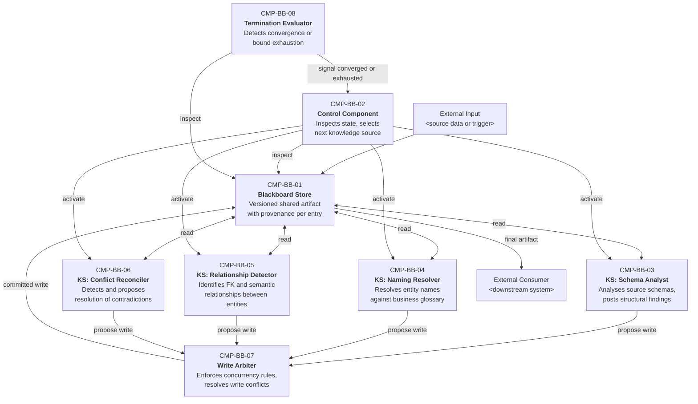
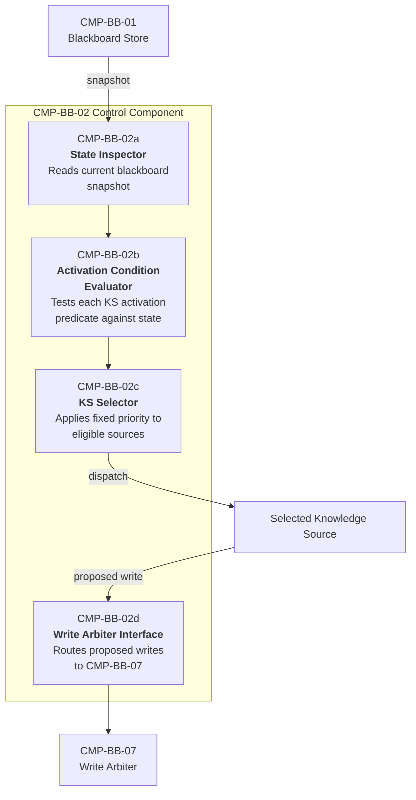
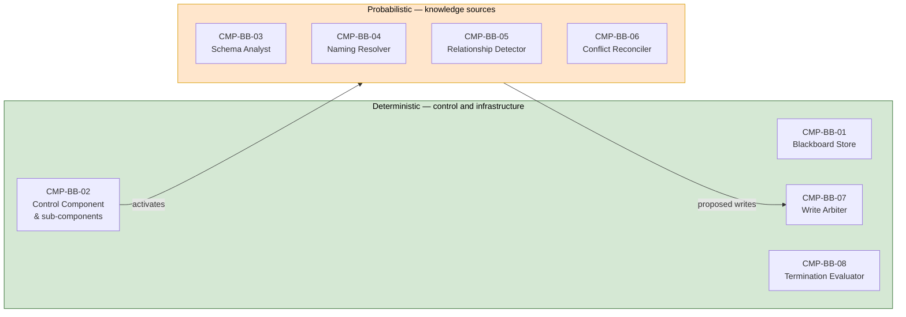
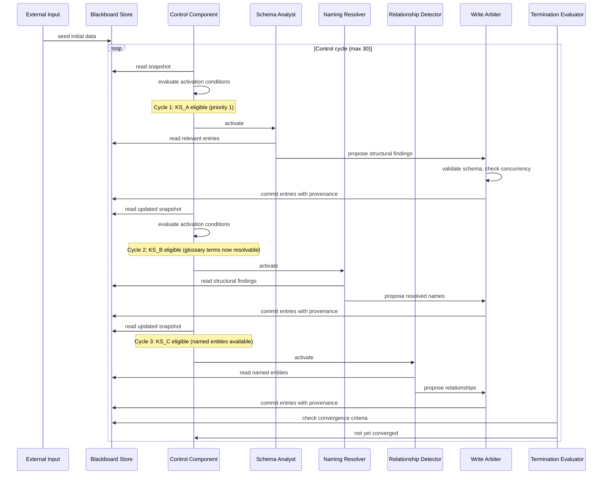
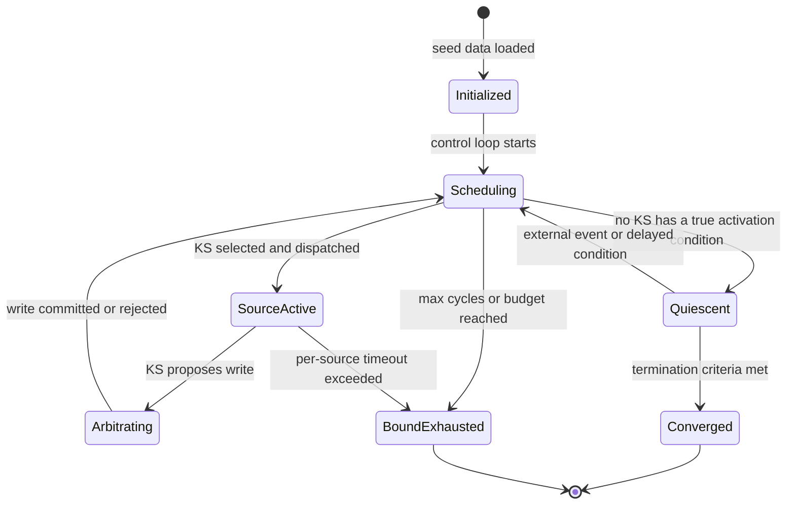
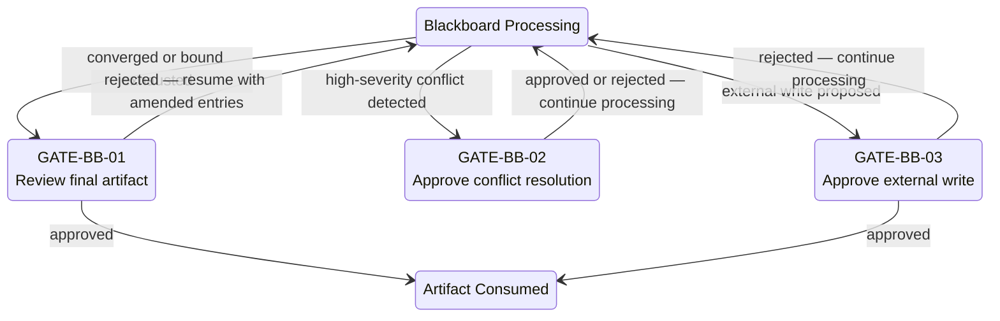

# Pattern 04 — Blackboard / Shared State

| Field | Value |
|---|---|
| Pattern ID | `PAT-04` |
| Name | Blackboard / Shared State |
| Autonomy level | High — execution path emerges from shared state, not from a coordinator or a fixed sequence |
| Pre-fills LLD sections | §5.1, §5.2 (structure), §5a.1 (determinism boundary), §6 (runtime sequences), §5a.5 (gate placement), §11.1 (failure modes) |
| Sources | Buschmann et al., *POSA Vol. 1* (Blackboard); Erman, Hayes-Roth, Lesser & Reddy (1980), *The Hearsay-II Speech-Understanding System*, ACM Computing Surveys 12(2); Nygard, *Release It!*; Anthropic, *Building Effective Agents* (2024) |

---

## 0. DDLC Agent Studio Runtime Mapping

- **Catalog Pattern ID**: `PAT-04` -> governs the internal state architecture of the **Layer 1 DDLC Meta-Agent** (`src/state/blackboard.py` + `projections.py`, using `PostgresSaver` checkpoints and the "Deterministic-control blackboard" variant where the Coordinator is 100% deterministic Python and Specialists operate on narrow State Projections).
- **Layer 2 Generated Agent Guidance**: For Layer 2 DDLC agents (`agent.yaml`), avoid general `PAT-04` unless reconciling heterogeneous multi-source catalogs (`multi_source_lineage_inspector`) with explicit snapshot versioning and deterministic write arbitration. Prefer `stateful_pipeline_with_gates` (`PAT-01`) whenever processing order is known at design time.
- **Key Implementation Primitives**: Append-only state slices (`contracts` dictionary / revision lists), `MetadataCallbackHandler` audit trail (`execution_log`, `decision_log`), and explicit human gates (`GATE-BB-03`) prior to external writes.

---

## 1. Intent and applicability

**Intent.** Enable multiple independent specialist agents to contribute partial solutions to a
problem by reading and writing a shared structured store, with no predetermined execution order. A
control component inspects the blackboard state after each write and selects which specialist to
activate next. The solution path emerges from what the specialists collectively discover.

**Applicable when all of these hold:**

- The solution path genuinely cannot be predetermined — the information needed to decide which step
  comes next is not available until a prior step has deposited its results.
- Multiple independent specialists contribute partial, heterogeneous analyses to a common artifact.
- A shared evolving artifact (the blackboard) is the natural representation of intermediate state —
  no single agent owns or produces the entire output.
- Cross-run or cross-source reconciliation against a common registry is the task shape — several
  independent analyses must converge on one shared truth.

**Not applicable when:**

- Output must be **reproducible** — emergent write ordering means two identical runs may produce
  different intermediate states and different final results. This is not a fixable deficiency; it is
  inherent in the pattern.
- Output must be **auditable** to a regulator or an accountable stakeholder — the causal chain from
  input to output passes through a write order that is itself emergent and that no single component
  controls.
- The processing steps are actually known at design time — use `01-staged-gated-pipeline.md`.
- The work decomposes into independent subtasks that do not share state — use
  `02-orchestrator-workers.md`.

> This pattern is the weakest fit for regulated enterprise workloads in the catalog. The comparison
> matrix in `README.md` §2.3 rates it Low on determinism, Weak on reproducibility, Poor on
> auditability, and Hard on debuggability. Use it only when the task genuinely requires emergent
> coordination — and constrain it with the deterministic-control variant in §12.

---

## 2. Problem and forces

A class of problems exists where no single specialist can produce the solution, the order of
contributions cannot be fixed, and partial results from one specialist unlock further contributions
from others. The blackboard pattern addresses this — but at a price.

| Force | Tension |
|---|---|
| Flexibility vs predictability | Opportunistic activation lets the system respond to whatever it finds — but the execution trace varies between runs |
| Specialist independence vs coherence | Each knowledge source operates autonomously — but their combined writes must converge to a coherent artifact |
| Opportunistic contribution vs write-order determinism | Allowing any specialist to write at any time maximises coverage — but makes the write sequence non-reproducible |
| Shared mutable state vs isolation | A shared store lets specialists build on each other's work — but creates read-write coupling, lost updates, and stale reads |
| Convergence vs termination | The system should run until the artifact is complete — but there is no structural guarantee that it converges or terminates |

> The forces trade away exactly the properties that regulated workloads need: reproducibility,
> auditability, bounded cost, and explainable causation. These are not implementation gaps to be
> patched — they are structural consequences of the pattern's shape. Every adoption must justify why
> the flexibility gained outweighs the properties lost.

---

## 3. Structure (C4 Level 2 and Level 3)

### 3.1 C4 Level 2 — Container diagram



### 3.2 C4 Level 3 — Control Component internals



---

## 4. Participants

| ID | Name | Responsibility | Determinism class |
|---|---|---|---|
| `CMP-BB-01` | Blackboard Store | Holds the versioned shared artifact with per-entry provenance | Deterministic |
| `CMP-BB-02` | Control Component | Inspects blackboard state and selects the next knowledge source to activate | Deterministic (strongly recommended) |
| `CMP-BB-02a` | State Inspector | Reads a consistent snapshot of the current blackboard | Deterministic |
| `CMP-BB-02b` | Activation Condition Evaluator | Tests each knowledge source's activation predicate against the snapshot | Deterministic |
| `CMP-BB-02c` | KS Selector | Chooses among eligible sources using a fixed priority order | Deterministic |
| `CMP-BB-02d` | Write Arbiter Interface | Routes proposed writes from the active source to the arbiter | Deterministic |
| `CMP-BB-03` | KS: Schema Analyst | Analyses source schemas and posts structural findings to the blackboard | Probabilistic |
| `CMP-BB-04` | KS: Naming Resolver | Resolves entity names against a business glossary | Probabilistic |
| `CMP-BB-05` | KS: Relationship Detector | Identifies FK and semantic relationships between entities | Probabilistic |
| `CMP-BB-06` | KS: Conflict Reconciler | Detects contradictions between entries and proposes resolutions | Probabilistic |
| `CMP-BB-07` | Write Arbiter | Enforces optimistic concurrency and resolves conflicting writes | Deterministic |
| `CMP-BB-08` | Termination Evaluator | Detects quiescence, convergence, or bound exhaustion | Deterministic |

> Every probabilistic knowledge source's output passes through the deterministic Write Arbiter
> before reaching the blackboard. This satisfies MK-1's requirement that no probabilistic output
> reaches a write without a deterministic validator.

---

## 5. Determinism boundary

> Satisfies `VP-AGENTIC` MK-1 (LLD §5a.1).



**The single most important design decision in this pattern is the determinism class of the Control
Component.** If the control loop itself uses probabilistic decision-making (an LLM choosing which
source to activate), then the activation sequence varies between runs, which varies the write order,
which varies the intermediate states visible to later sources, which varies their output.
Non-determinism in the control loop propagates to every downstream decision — almost nothing is
reproducible, and the causal chain becomes untraceable.

**Strong recommendation:** make the control component fully deterministic. Implement activation
conditions as rule-based predicates over the blackboard schema, and apply a fixed priority order when
multiple sources are eligible. The knowledge sources themselves may be probabilistic — that is the
value of the pattern — but the decision of *which source runs when* must not be.

| Component | Judgement delegated | Bound | Validator |
|---|---|---|---|
| `CMP-BB-03` | Structural analysis of source schemas | 5 000 tokens / invocation | `CMP-BB-07` (schema conformance of proposed entry) |
| `CMP-BB-04` | Entity-name resolution against glossary | 3 000 tokens / invocation | `CMP-BB-07` (glossary-hit validation) |
| `CMP-BB-05` | Relationship identification between entities | 5 000 tokens / invocation | `CMP-BB-07` (referential integrity check) |
| `CMP-BB-06` | Contradiction detection and resolution proposal | 4 000 tokens / invocation | `CMP-BB-07` (conflict-resolution rule compliance) |

---

## 6. Runtime behaviour

### 6.1 Opportunistic contribution sequence



### 6.2 Write-conflict resolution sequence

```mermaid
sequenceDiagram
    participant KS_B as Naming Resolver
    participant KS_C as Relationship Detector
    participant ARB as Write Arbiter
    participant BB as Blackboard Store
    participant KS_D as Conflict Reconciler
    participant CTRL as Control Component

    Note over KS_B,KS_C: Both activated in consecutive cycles;<br/>propose contradictory entries for entity E-42
    KS_B->>ARB: propose name "Customer" for E-42 (confidence 0.82)
    KS_C->>ARB: propose name "Client" for E-42 (confidence 0.76)
    ARB->>ARB: detect conflict on E-42.name
    ARB->>BB: commit both as provisional (status=conflicted)
    ARB->>CTRL: signal conflict on entry class ENTITY_NAME
    CTRL->>CTRL: activation condition for KS_D now true
    CTRL->>KS_D: activate with conflict reference
    KS_D->>BB: read conflicted entries for E-42
    KS_D->>ARB: propose resolution - "Customer" (evidence: 3 upstream refs vs 1)
    ARB->>ARB: validate resolution rule compliance
    ARB->>BB: commit resolution, supersede provisional entries
```

### 6.3 Lifecycle state machine



---

## 7. State contracts

> Satisfies LLD `CTR-` requirements. Unlike patterns 01–03, the blackboard schema is the central
> contract — it is many-to-many rather than point-to-point, which is precisely why it is harder to
> maintain and version.

### 7.1 Blackboard schema contract

| Contract ID | Name | Parties | Invariant |
|---|---|---|---|
| `CTR-BB-01` | Blackboard Schema | All knowledge sources, Write Arbiter | Every entry conforms to the versioned schema; entries with an unrecognised schema version are rejected |
| `CTR-BB-02` | Entry Provenance | Write Arbiter, Blackboard Store | Every entry records source ID, timestamp, evidence references, and confidence score |
| `CTR-BB-03` | Append-Only Supersession | All writers | Entries are never mutated in place; a new entry supersedes a prior entry by reference, preserving the full history |
| `CTR-BB-04` | Optimistic Concurrency | Write Arbiter, Knowledge Sources | Each proposed write carries the snapshot version it was based on; stale writes are rejected |
| `CTR-BB-05` | Read Consistency | Control Component, Knowledge Sources | A source reads a consistent snapshot as of a declared version; it does not observe partial writes from concurrent sources |

> **Strongly prefer append-only with supersession** (`CTR-BB-03`). Mutable entries destroy the audit
> trail and make it impossible to reconstruct how the blackboard reached its final state. If entries
> are mutable, every mutation must be logged — but append-only makes the log structural rather than
> relying on a side-channel.

### 7.2 Concrete blackboard entry payload

```json
{
  "entry_id": "ENT-20260401-0042",
  "schema_version": "1.3.0",
  "entry_type": "ENTITY_NAME",
  "subject_ref": "E-42",
  "value": "Customer",
  "confidence": 0.82,
  "status": "accepted",
  "supersedes": "ENT-20260401-0031",
  "provenance": {
    "source_id": "CMP-BB-04",
    "source_run_id": "run-7a3f",
    "timestamp_utc": "2026-04-01T14:23:07Z",
    "evidence_refs": ["ENT-20260401-0012", "ENT-20260401-0019"],
    "snapshot_version": 17
  }
}
```

### 7.3 Read-consistency model

The read-consistency question — does a knowledge source see a consistent snapshot or live state? —
is critical and under-specified in most blackboard implementations.

| Option | Behaviour | Trade-off |
|---|---|---|
| Snapshot isolation | Source reads state as of a declared version; concurrent writes invisible | Predictable source behaviour; may miss recent contributions |
| Read-committed | Source sees all committed writes at read time | Richer context; source output may vary if reads interleave with writes |

**Recommendation:** snapshot isolation with explicit version. It makes source behaviour more
predictable and makes the write-order sensitivity problem tractable to analyse. Record the snapshot
version in every entry's provenance so the causal chain is reconstructable.

---

## 8. Bounds, budgets and termination

> Satisfies `VP-AGENTIC` MK-1 bounds, MK-3 tool authority (LLD §5a.1, §5a.3).

**Termination is the weakest point of this pattern.** Unlike patterns 01–03, the blackboard has no
structural termination guarantee. There is no fixed stage count, no iteration ceiling inherent in the
design. Every bound must be explicit, and every bound must be enforced by the deterministic
Termination Evaluator — never by a knowledge source.

| Bound | Value | Enforced by | Consequence of breach |
|---|---|---|---|
| Max control cycles | 30 | `CMP-BB-08` | Transition to `BoundExhausted`; emit partial artifact with incomplete status |
| Per-source invocation budget | 8 activations per source per run | `CMP-BB-02` | Source becomes ineligible for remainder of run |
| Per-source timeout | 60 s wall-clock | `CMP-BB-02` | Source killed; cycle counted; activation logged as timed-out |
| Total token budget | 120 000 tokens across all sources | `CMP-BB-02` | Transition to `BoundExhausted` |
| Total wall-clock budget | 600 s | `CMP-BB-08` | Hard stop; transition to `BoundExhausted` |
| Progress requirement | A cycle that commits zero new or superseding entries counts as no-progress cycle; 3 consecutive no-progress cycles trigger quiescence | `CMP-BB-08` | Prevents livelock where sources re-read but never advance state |

> The progress requirement is essential. Without it, a source that reads, finds nothing actionable,
> and returns without writing will cause the control loop to re-evaluate, potentially re-activate the
> same source, and loop indefinitely. Every cycle that changes nothing must count toward the bound.

---

## 9. Human-in-the-loop gate placement

> Satisfies `VP-AGENTIC` MK-5 (LLD §5a.5).

**Gates fit awkwardly in this pattern.** In a pipeline, gates sit between stages — the stage
boundary is a natural freeze point. In the blackboard, there is no stage boundary. State evolves
continuously, and freezing it at an arbitrary control cycle means the gate's context is whatever the
emergent write order happened to produce by that point. This makes the gate's guarantee weaker than
in any other pattern.

**Workable gate placements:**

| Gate ID | Placement | Trigger | What the human sees |
|---|---|---|---|
| `GATE-BB-01` | On quiescence, before the final artifact is consumed | Termination Evaluator signals `Converged` or `BoundExhausted` | Full blackboard state, entry-by-entry provenance, conflict resolution log |
| `GATE-BB-02` | On arbitration of a high-severity conflict class | Write Arbiter detects conflict on entry class `ENTITY_NAME` or `RELATIONSHIP` | The conflicting entries, evidence references, and proposed resolution |
| `GATE-BB-03` | Before any write that escapes the blackboard to an external system | Any component attempts an external side effect | The proposed external write and the blackboard entries that justify it |



### Gate contract table

| Gate ID | Artifact presented | Permitted decisions | State frozen on approval | Freeze clause |
|---|---|---|---|---|
| `GATE-BB-01` | Complete blackboard with provenance trail | Approve / Reject / Amend specific entries | All blackboard entries at current version | No further writes to the blackboard after approval; any downstream consumer reads the frozen version |
| `GATE-BB-02` | Conflicting entries and resolution proposal | Approve resolution / Choose alternative / Defer to human classification | The two conflicting entries and the resolved entry | Conflict is sealed; neither conflicting entry may be superseded except through a new `GATE-BB-02` cycle |
| `GATE-BB-03` | Proposed external write with justification entries | Approve / Reject / Amend payload | The proposed external payload and its source entries | External write is executed exactly once on approval; no replay without a new gate cycle |

---

## 10. Failure modes

| FM ID | Name | Description | Likelihood | Severity | Mitigation |
|---|---|---|---|---|---|
| `FM-BB-01` | Livelock | Control cycles execute but no source commits new entries; system spins without progress | Medium | High | Progress requirement bound (§8); 3 consecutive no-progress cycles trigger quiescence |
| `FM-BB-02` | Write conflict with no resolution rule | Two sources propose contradictory entries for a subject with no arbiter rule covering that entry class | Medium | High | Write Arbiter rejects both and marks subject as `needs-human-resolution`; `GATE-BB-02` activates |
| `FM-BB-03` | Lost update | A source reads stale snapshot, proposes a write that the arbiter commits, overwriting a more recent entry | Medium | High | Optimistic concurrency via snapshot version (`CTR-BB-04`); stale writes rejected |
| `FM-BB-04` | Stale read | Source operates on an outdated snapshot and produces irrelevant or contradictory output | Medium | Medium | Snapshot version recorded in provenance; downstream consumers can detect and discard |
| `FM-BB-05` | Source thrashing | Two sources repeatedly supersede each other's entries, oscillating between two values | Low | High | Oscillation detector in Termination Evaluator; after 3 supersession cycles on the same subject, escalate to `GATE-BB-02` |
| `FM-BB-06` | Control starvation | A source's activation condition is perpetually shadowed by higher-priority sources; it never activates | Medium | Medium | Activation audit log; alert if any source has zero activations after 10 cycles |
| `FM-BB-07` | Non-reproducible output | Different write ordering across runs produces different final artifacts from identical input | High | Context-dependent | Accept and quantify divergence (§11); or adopt deterministic-control variant (§12) |
| `FM-BB-08` | Unbounded cycle growth | No effective bound; control loop runs until external timeout | Low | Critical | Explicit max-cycle and wall-clock bounds in `CMP-BB-08` (§8) |
| `FM-BB-09` | Provenance loss | Entries committed without source ID, evidence refs, or snapshot version | Low | Critical | Write Arbiter rejects any entry missing mandatory provenance fields (`CTR-BB-02`) |
| `FM-BB-10` | Partial/incoherent final state | Bound exhaustion leaves the blackboard with unresolved conflicts, provisional entries, or incomplete coverage | Medium | High | `GATE-BB-01` presents partial state with explicit incomplete markers; consumer must not treat partial as complete |

---

## 11. Observability and eval strategy

### 11.1 Observability

> Satisfies LLD §8.3 and the `VP-AGENTIC` requirement that MK-1/MK-4 claims be observable at
> runtime. The blackboard mutation log is the primary audit artifact — without it, this pattern is
> undebuggable.

| Signal | Type | Granularity | Purpose |
|---|---|---|---|
| Control-cycle span | Trace (OTel) | One span per cycle | Cycle duration, which source activated, outcome |
| Source-invocation span | Trace (OTel) | One span per KS activation | Source latency, token count, entry count proposed |
| Blackboard mutation log | Append-only event log | One event per committed or rejected write | Full provenance, snapshot version, conflict flag — the reconstructable audit trail |
| Progress-per-cycle metric | Gauge | Per cycle | New entries + superseding entries committed; zero indicates no-progress cycle |
| Source activation counts | Counter | Per source, per run | Detects starvation (`FM-BB-06`) and dominance |
| Conflict rate | Counter | Per entry class, per run | Elevated rate signals schema ambiguity or source disagreement |
| Snapshot version at read | Log attribute | Per source invocation | Enables reconstruction of what each source saw |

### 11.2 Eval strategy

> Satisfies `VP-AGENTIC` MK-6 (LLD §5a.6). This pattern has weak reproducibility by design; the
> eval strategy must account for that rather than pretend otherwise.

| Eval ID | Name | Method | Pass criterion |
|---|---|---|---|
| `EV-BB-01` | Blackboard invariant assertions | Property-based tests asserting schema conformance, provenance completeness, and referential integrity of all entries after every cycle | Zero violations across 50 randomised-order runs |
| `EV-BB-02` | Determinism probe | Run the same input twice with identical model, seed, and snapshot isolation; diff the final blackboard entry-by-entry | Measure divergence — do not assert zero. Report divergent entry count, entry classes affected, and maximum confidence delta |
| `EV-BB-03` | Convergence rate | Measure cycles-to-quiescence and entries-at-convergence across a corpus of 20 representative inputs | p95 cycles-to-quiescence below max-cycle bound; zero unresolved conflicts in converged runs |
| `EV-BB-04` | Invariant preservation under interleaving | Permute source activation order (where multiple sources are eligible) and assert blackboard invariants hold | Invariants hold across all tested interleavings (minimum 10 permutations per input) |
| `EV-BB-05` | Bound enforcement | Inject a source that never terminates and a source that always conflicts; verify bounds and escalation fire | Livelock detected within 3 no-progress cycles; timeout fires within 60 s; conflict escalates to gate |

> **Reproducibility claim (MK-6):** Given identical input, model version, and deterministic control
> component, the set of entry *types* and *subjects* present in the final blackboard is expected to
> be stable. The specific *values*, *confidence scores*, and *write order* are not claimed
> reproducible. `EV-BB-02` quantifies the divergence on every release.

---

## 12. Consequences, variants and anti-patterns

### 12.1 Consequences

| Consequence | Positive / Negative | Detail |
|---|---|---|
| Specialist independence | Positive | Knowledge sources can be developed, tested, and replaced independently; adding a new source does not require changing existing ones |
| Emergent problem-solving | Positive | The system can discover solution paths that no single source or fixed sequence would find |
| Natural fit for reconciliation tasks | Positive | Multiple analyses converging on a shared registry is the pattern's strongest use case |
| Poor reproducibility | **Negative** | Write-order variance produces different final states from identical input; quantifiable but not eliminable |
| Poor auditability | **Negative** | The causal chain passes through an emergent write order that no component controls and that an auditor cannot reconstruct without the full mutation log |
| Hard debugging | **Negative** | A defective entry may result from a chain of reads and writes across multiple sources and cycles; root-cause analysis requires replaying the mutation log |
| High operational cost | **Negative** | Opportunistic activation means token and compute consumption varies unpredictably between runs |
| Emergent behaviour | **Negative** | Source interactions can produce unexpected outcomes that are difficult to bound, test, or explain to an accountable stakeholder |
| No structural termination | **Negative** | Every termination condition must be explicitly designed, implemented, and tested; the pattern provides none for free |

### 12.2 Variants

| Variant | Description | Suitability |
|---|---|---|
| **Deterministic-control blackboard** | Control component is fully rule-based with fixed priority; only knowledge sources are probabilistic | **Strongly recommended.** The only variant suited to regulated use. Eliminates `FM-BB-07` for the activation sequence, though source output remains non-deterministic |
| **Append-only event-sourced blackboard** | All entries are immutable events; current state is a projection | Excellent for auditability; the mutation log *is* the blackboard. Higher storage cost; requires a projection layer |
| **Registry reconciliation** | Multiple independent runs reconcile against one shared registry with deterministic match rules and HITL approval on every write | A narrow, well-behaved, and genuinely useful special case. Deterministic matching eliminates most write-order sensitivity; HITL approval on writes (`GATE-BB-03`) provides the auditability the general pattern lacks. This is where blackboard is most defensible in enterprise use |

> **Registry reconciliation is the recommended entry point** for teams considering this pattern.
> It constrains the blackboard to its strongest use case, adds deterministic match rules that
> reduce write-order sensitivity, and places a human gate on every external write. If your problem
> fits this shape, start here rather than with the general pattern.

### 12.3 Anti-patterns

| Anti-pattern | Why it fails |
|---|---|
| Probabilistic control loop | An LLM choosing which source to activate makes the activation sequence non-deterministic; non-determinism propagates to every downstream write and destroys any remaining reproducibility. See §5. |
| Mutable entries without provenance | If entries are overwritten in place without provenance, the blackboard's history is lost and the final state cannot be explained. Violates `CTR-BB-02` and `CTR-BB-03`. |
| No write arbitration | Without `CMP-BB-07`, concurrent or contradictory writes go unchecked; lost updates (`FM-BB-03`) and incoherent state (`FM-BB-10`) are inevitable. |
| Using blackboard where a pipeline would do | If the processing steps are known at design time, the blackboard's flexibility is pure overhead and its drawbacks are uncompensated. Use `01-staged-gated-pipeline.md`. |
| Claiming reproducibility | Asserting that the blackboard produces identical output across runs is a false claim. The correct posture is to quantify divergence (`EV-BB-02`) and accept it, not to deny it. |
| No explicit termination bound | Relying on convergence without a hard cycle or wall-clock bound invites `FM-BB-08`. The pattern has no intrinsic stop condition; you must supply one. |
